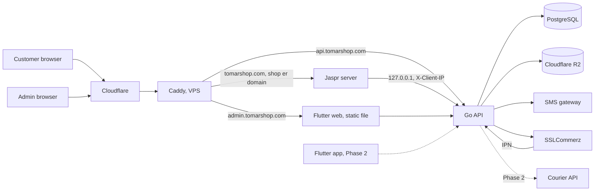
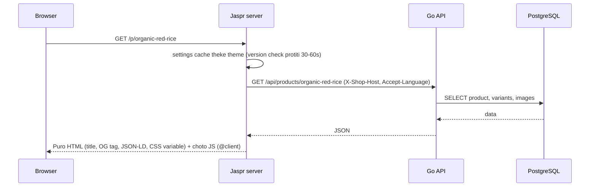
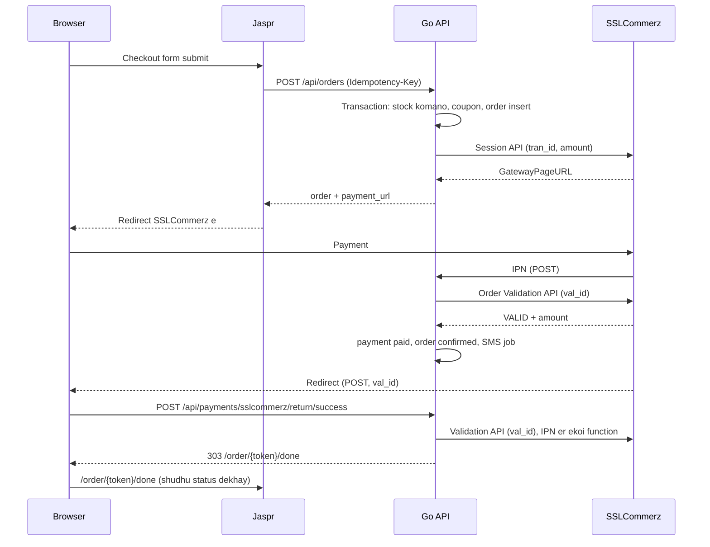
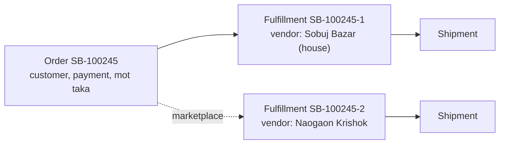

> ESD design er ongsho · [Suchipotro ar version](README.md) · Shob kaj e age: Section 1.4 ([01-overview.md](01-overview.md))

## 3. System architecture

### 3.1 Component gulo

| Component | Kaj | Ki korbe na |
|---|---|---|
| Go API | Shob business niyom, database, payment, SMS, job | HTML banabe na |
| Jaspr server | Customer website er HTML (SSR), cookie session, SEO, browser er jonno BFF endpoint (10.9) | Dam/stock/discount hishab korbe na |
| Flutter web admin | Admin ar staff er UI | Database e shorasori jabe na |
| PostgreSQL | Shob data | Business logic (trigger e logic rakhbe na) |
| R2 | Chobi ar file | Private data (invoice, NID) public bucket e na |

Shob client (website, admin, app) shudhu Go API er maddhome kaj kore. Go API-i ekmatro jinish jeta database chhoy.

### 3.2 Shop ar vendor chena

Protiti request kon shop er (ar vendor staff hole kon vendor er), sheta Go API thik kore ar `context` e rakhe. Ek middleware shob route e na; route er dhoron onujayi alada resolver:

| Route | Shop kivabe chena | Na pele |
|---|---|---|
| Public (`/api/...`, website ar app) | `X-Shop-Host` header (customer je domain e ache, jemon `sobujbazar.com`) → `shop_domains`. App pathay shop er primary domain | `404 shop_not_found` |
| Customer login lagbe emon | Upore moto, tarpor session er `shop_id` mile kina | `401` |
| Admin (`/api/admin/...`) | Staff session theke (`shop_id`, `vendor_id`, role). Login body te `shop` (slug) | `401` |
| Payment IPN, return URL | `tran_id` → `payments.shop_id` (request e `X-Shop-Host` thake na) | `404`, log |
| Courier webhook (Phase 2) | URL e shop: `/api/webhooks/{carrier}/{shop}` + secret | `404` |
| `/healthz`, platform API (Phase 3) | Shop lage na | |

Niyom:

1. Jaspr server customer er `Host` header ta-i `X-Shop-Host` e pathay, nije slug khoje na. Domain theke shop er map Go API e (`shop_domains`, memory cache 60 second).
2. `shops.status = 'suspended'` hole public API `423 shop_suspended`, website "dokan ekhon bondho" page dekhay. Admin login cholbe, jate owner data dekhte pare. v1.10: `closed` hole public API `404 shop_not_found` (closed shop e admin login cholbe kina M4 er age).
3. Staff row e `vendor_id` thakle (vendor staff) session e `vendor_id` boshe, ar admin API er protiti query te `vendor_id` filter (Rule 13). Shop er staff (`vendor_id` NULL) shob vendor dekhe.
4. Ek manush duita shop e kaj korle duita alada staff row, alada login. Ek login e onek shop lagle pore `accounts` + `memberships` migration (16.1).
5. **Client IP**: Cloudflare er IP range shudhu Caddy dekhe: `trusted_proxies` e Cloudflare range ar `client_ip_headers CF-Connecting-IP`, tarpor Jaspr ar Go API duijon-er kache `X-Real-IP` header e asol IP; client er pathano `X-Client-IP` ar `X-Internal-Auth` Caddy muche dey (13.3). Shob connection Caddy theke ashe (127.0.0.1), tai app nije Cloudflare range dekhe kichu bujhte pare na. Jaspr `X-Real-IP` niye API te `X-Client-IP` e pathay, shathe `X-Internal-Auth: <JASPR_INTERNAL_SECRET>`. Go API: loopback + thik secret hole `X-Client-IP`; loopback (Caddy) hole `X-Real-IP`; na hole connection er IP. Rate limit, `orders.ip`, `sessions.ip`, `many_orders` flag ei IP diye. Na korle website, admin ar app er shob request ek IP hoye jay, ar 7.8 er limit e puro site atke jay.
6. `www` er request Caddy `301` diye apex e pathay (13.3), tai `shop_domains` e `www` lage na.

MVP te ekta shop ar ekta vendor, kintu code shuru thekei ei niyom mene likhte hobe.

### 3.3 Product page request (SSR)

### 3.4 Checkout ar online payment

Website er success page kokhono payment "paid" korbe na. Backend IPN ba success return er `val_id` diye Validation API call kore (server-to-server, Rule 7), ar IPN harale reconcile job Transaction Query API diye dhore (8.9).

### 3.5 Settings publish ar cache

1. Admin theme/naam bodlay, draft e save hoy.
2. "Preview" e ekta signed preview token diye website khole, draft dekhay.
3. "Publish" e draft `published` e copy hoy, `version` ek barhe, `settings_history` e purono ta jay.
4. Jaspr server protiti 30–60 second e `GET /api/settings/version` check kore. Version bodlale `GET /api/settings` theke notun settings ane.
5. Fole publish er 1 minute er moddhe shob customer notun design dekhe.
6. v1.13: Jaspr er cache host onujayi, translation shoho, background refresh, API down e purono (10.10). Translation override save (M8) e o `version` barbe, na hole porer publish porjonto purono lekha.

### 3.6 Background job

Go API process er bhetore ekta worker goroutine `jobs` table theke kaj nay: SMS pathano, invoice, delivery deadline alert, low stock alert, expiry alert, COD confirm na hole auto-cancel. Kaj gulo idempotent (duibar cholle-o khoti nai). Fail hole backoff diye abar cheshta, `max_attempts` er por `failed_at` boshe ar admin alert (worker crash korle `jobs.sweep`, 6.4).

### 3.7 Order, fulfillment ar vendor

| Jinish | Order e | Fulfillment e |
|---|---|---|
| Customer, thikana, payment, coupon, delivery deadline | Hya | |
| Status | `pending → confirmed` (ba `cancelled`) | `open → packed → shipped → delivered` (ba `cancelled`, `returned`) |
| Taka | Mot subtotal, discount, delivery charge, total | Ei vendor er bhag (pricing, 8.5). COD hole courier eta-i tole |
| Pack, ship, deliver, batch | | Hya |

Customer ar admin ekta status dekhe: `orders.display_status`, jeta `order.Summary` (8.8) diye hishab hoy. Single store e fulfillment ekta, tai `display_status` hubohu v1.0 er status (`pending`, `confirmed`, `packed`, `shipped`, `delivered`, `cancelled`, `returned`). Marketplace e vendor gulo alada stage e thakle `partial`.

Single store e admin UI te fulfillment alada dekhabe na: order page e ekta status, ekta "Packed" button. Button ta backend e oi order er ekmatro fulfillment ke transition kore.

### 3.8 Notun shop khola

Ekta command (MVP te CLI, Phase 3 e platform admin): `shop-api shop create --slug sobujbazar --prefix SB --domain sobujbazar.com --owner-email ...`. v1.10: shathe `--name-bn` (lagbe), `--name-en`, `--owner-name` (lagbe), `--preset` (default `organic`, 9.4); house vendor er slug ar naam shop er, `branding.name` = shop er naam; temporary password `crypto/rand` diye, stdout e ekbar (log e na). Ek transaction e:

1. `shops` (`mode = 'single'`), `shop_domains` (primary).
2. House vendor (`vendors`, `is_house = true`).
3. `shop_settings` (preset theke, draft = published, version 1), `shop_counters` (`order_number = 0`).
4. Owner staff (temporary password, `must_change_password = true`; prothom login e password bodlano ar TOTP setup badhyotamulok, tarpor 10 ta recovery code dekhay).

Shop er credential (SMS, SSLCommerz) set korar CLI: `shop-api credentials set --shop sobujbazar --provider sms` (stdin theke JSON). M8 er admin screen er age M4 ei eta lage.

Shop ke marketplace banano: `shops.mode = 'marketplace'`, tarpor notun vendor jog. Kono data migration lage na, karon purono shob product, order, fulfillment already house vendor er.
