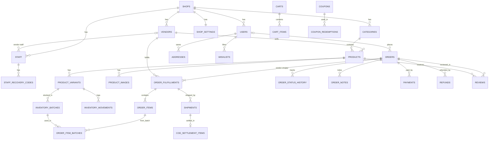

> ESD design er ongsho · [Suchipotro ar version](README.md) · Shob kaj e age: Section 1.4 ([01-overview.md](01-overview.md))

## 6. Database design

Puro schema PostgreSQL 16 e chaliye test kora hoyeche (table, constraint, index, niche-r query gulo, ar 6.4 er bhul atkano). File ta `backend/migrations/001_init.sql` e rakho; test `backend/migrations/tests/001_init_test.sql` (83 ta test, protiti reject test e constraint er naam, shesh e `ROLLBACK`) M0 theke CI te chalao. Puro SQL file e-i (6.7 e link); v1.6 theke doc e copy nai.

### 6.1 Database er niyom

| Bishoy | Niyom |
|---|---|
| Primary key | `BIGINT GENERATED ALWAYS AS IDENTITY` |
| Taka | `BIGINT` poisha. Column naam e `_price`, `amount`, `total`, `charge` |
| Shomoy | `TIMESTAMPTZ`, UTC te. Dekhano shop er timezone e (`shops.timezone`) |
| Shudhu tarikh | `DATE` (expiry, harvest) |
| Bhashar lekha | `JSONB` `{"bn": "...", "en": "..."}`. Na thakle `bn` fallback |
| Status | `TEXT` + `CHECK (... IN (...))`. Postgres `ENUM` na, karon bodlano kothin |
| Multi-tenant | Protiti business table e `shop_id NOT NULL`, child table eo. Parent e `UNIQUE (shop_id, id)`, child er foreign key `(shop_id, parent_id)`. Protiti query te `WHERE shop_id = $1` |
| Vendor | Catalog, order item, fulfillment, shipment e `vendor_id NOT NULL` (single store e house vendor). Vendor staff er query te `AND vendor_id = $2` |
| Phone | `phone_bd` domain: `+8801XXXXXXXXX` (E.164). Bhul format database-i atkay |
| Secret | Kokhono plain text na. Token er `sha256`, password er `pbkdf2`, credential AES-GCM, staff TOTP secret AES-GCM (`TOTP_KEY`, v1.5) |
| Delete | Order, payment, review kokhono hard delete na (app role er DELETE permission-i nai). Product `is_active = false`. Customer account delete = anonymize (phone, naam, email `NULL`) |
| Migration | Shudhu notun file jog (`002_...sql`). Deploy hoya migration file kokhono edit na. Runner protiti file ar `schema_migrations` er insert ek transaction e chalay: shurute `pg_advisory_xact_lock` niye `schema_migrations` abar dekhe, tarpor `SELECT set_config('app.env', $1, true)` (`APP_ENV`). v1.6: session-level `pg_advisory_lock` `database/sql` er pool e onno connection e pore jete pare, ar `SET LOCAL` parameter ney na (Rule 12). Runner shudhu `backend/migrations/*.sql` embed kore (`backend/migrations/embed.go`, karon `go:embed` `..` path ney na); test `tests/` subfolder e, tai migration hishebe chole na. v1.7: `schema_migrations (version, sha256, applied_at)`; runner lock er por protiti applied file er sha256 mile kina, ar shesh applied number er cheye choto number er notun file ache kina dekhe; ekta-o hole kono migration na chaliye fail. Deploy er por file bodlano eta-i asol bhabe dhore; `DEPLOYED` (13.6) Claude Code ar CI er agam shotorkota |
| DB role | Migration chalay table er malik (`MIGRATE_DATABASE_URL`), API chalay `shop_app` (`DATABASE_URL`): DDL nai, hard-delete-nishiddho table e DELETE nai, history/audit e UPDATE nai, shudhu `audit_logs.ip` muchar onumoti (`001` er shesh block). v1.7: `app.env` `local` chhara (na thakle ba khali holeo) `shop_app` na thakle `001` fail kore; ager version e shudhu staging/production e fail korto, `app.env` chhara chupchap skip hoto. v1.8: runner er `schema_migrations` e `shop_app` shudhu SELECT (`001` er shesh block). Notun migration er notun table default privilege e DELETE pay: hard-delete-nishiddho ba history table hole (jemon `vendor_ledger`) oi file e-i REVOKE |
| Locale | Database `C.UTF-8`, na hole `001` shuru tei fail kore |

### 6.2 Mul shomporko



### 6.3 Table gulor kaj

| Table | Kaj |
|---|---|
| `shops`, `shop_domains` | Tenant (dokan/website): mode (`single`/`marketplace`), order prefix, timezone, status, ar tar domain |
| `vendors` | Shop er bhetore seller. Single store e ekta house vendor (`is_house`) |
| `shop_settings`, `settings_history` | Theme, branding, bhasha, checkout setting (draft/published), purono version |
| `shop_credentials` | Shop er SSLCommerz, SMS, courier er secret (encrypted, sandbox/live shoho). R2 platform er, env e |
| `shop_counters` | Order number er counter (`SB-100001`) |
| `translations` | Admin er bodlano UI lekha (file er default er upore override) |
| `users` | Customer (phone diye chena). Guest er row thake na |
| `staff`, `staff_recovery_codes` | Admin/staff, password + 2FA, lockout, recovery code. `vendor_id` thakle vendor staff |
| `sessions` | Customer (`user_id`) ar staff (`staff_id`) er login token (hash). Staff er TOTP er opekkhay temp_token (`stage = 'mfa_pending'`) |
| `otp_codes` | OTP (hash), attempt gona |
| `addresses` | Customer er save kora thikana |
| `blocked_phones` | Fake order er number |
| `delivery_zones` | Kon area te delivery, charge, free delivery shima, same-day cutoff, 5/10 din deadline |
| `categories`, `products`, `product_variants`, `product_images` | Catalog. Stock variant e |
| `inventory_batches` | Batch: koto ashlo, koto baki, kena dam, harvest/expiry |
| `inventory_movements` | Stock er protiti bodol er itihash |
| `suppliers` | Krishok/supplier (Phase 2 te puro use) |
| `wishlists` | Login kora customer er wishlist (guest er ta cookie te) |
| `carts`, `cart_items` | Login ba guest cart |
| `coupons`, `coupon_redemptions` | Coupon ar ke kon order e use korlo (phone diye limit) |
| `orders`, `order_items`, `order_status_history` | Order (customer, payment, mot taka, `display_status`, coupon er shorto er snapshot), item snapshot (vendor, `variable_weight`, `discount_share`, `commission`, `commission_bps`; bad deya item `status = 'removed'`, taka 0), order ar fulfillment er status er itihash |
| `order_notes` | Staff er note ar phone call (confirm er jonno) |
| `order_fulfillments` | Ek order e ek vendor er ongsho: pack, ship, deliver er status ar taka er bhag |
| `order_item_batches` | Kon batch theke kon order e gelo. Kono batch e shomossha hole (recall) kon customer ke janate hobe bujha jay |
| `payments`, `refunds` | Online payment (`store_amount` shoho) ar refund (`kind`: cancel, reprice, return, duplicate, late_payment, manual), settlement mela |
| `shipments`, `cod_settlements`, `cod_settlement_items` | Fulfillment er parcel, ar courier theke COD taka mela |
| `reviews` | Order-bhittik review (ek order e ek product er ekta) |
| `complaints`, `privacy_requests` | Complaint log (`due_at` 72 ghonta, DCOG), data delete/export request |
| `jobs` | Background kaj er queue |
| `audit_logs` | Staff ke kokhon ki bodlalo |

### 6.4 Guruttopurno query (test kora)

Order number:

```sql
UPDATE shop_counters SET value = value + 1
WHERE shop_id = $1 AND name = 'order_number'
RETURNING value;              -- shops.order_prefix + "-" + (100000 + value)
```

Counter update checkout transaction er shesher dike (8.6), karon row er lock commit porjonto thake.

Stock komano (duijon ek shathe kinleo stock minus hobe na). Kono row update na hole stock shesh:

```sql
UPDATE product_variants v SET stock = v.stock - $1
FROM products p
WHERE v.id = $2 AND v.shop_id = $3 AND v.stock >= $1 AND v.is_active
  AND p.shop_id = v.shop_id AND p.id = v.product_id AND p.is_active;
```

Coupon use (limit, shomoy shoho). Kono row na pele coupon ar valid na:

```sql
UPDATE coupons SET used_count = used_count + 1
WHERE shop_id = $1 AND upper(code) = upper($2) AND is_active
  AND (usage_limit IS NULL OR used_count < usage_limit)
  AND (starts_at IS NULL OR starts_at <= now())
  AND (expires_at IS NULL OR expires_at > now())
RETURNING id, code, kind, value, min_order, max_discount, per_phone_limit, vendor_id, funded_by;  -- v1.4: shorto order e snapshot (8.6)
```

Phone onujayi coupon limit: upore UPDATE er **pore**, ek-i transaction e. UPDATE coupon row lock kore, tai ek-i phone er duita checkout ek shathe ashleo ditiyo ta prothom tar redemption dekhe (READ COMMITTED e protiti statement notun snapshot nay). Age count korle duitai 0 dekhe ar limit bhange; Isolation level default `READ COMMITTED`-i rakho, `REPEATABLE READ` e ei kram kaj kore na. Postgres 16 e duita concurrent transaction diye test kora:

```sql
SELECT count(*) FROM coupon_redemptions WHERE coupon_id = $1 AND phone = $2;
```

Idempotent order insert. Transaction er shurute key er lock niye abar check (8.6). Insert e kichu ferot na ele `ROLLBACK` kore ager order ferot dao:

```sql
SELECT pg_advisory_xact_lock(hashtextextended($1::text || ':' || $2, 0));  -- shop_id, idempotency_key
SELECT id, idempotency_hash FROM orders WHERE shop_id = $1 AND idempotency_key = $2;
INSERT INTO orders (...) VALUES (...)
ON CONFLICT (shop_id, idempotency_key) DO NOTHING
RETURNING id;
```

Search (Bangla, English, Banglish keyword tinta-i kaj kore, `pg_trgm` index). User er lekhar `\`, `%`, `_` Go te `\` diye escape kore `$2` e, asol lekha `$3` e; na hole `%` likhle shob product match kore. v1.3: `search_text` ar query duitai NFC (`normalize`), tai "ো" ek code point e ba "ে" + "া" diye lekha hok, mile jay (Go te `x/text` lage na). 2 okkhorer kom hole search na:

```sql
SELECT id, slug, name FROM products
WHERE shop_id = $1 AND is_active AND search_text ILIKE '%' || normalize($2, NFC) || '%'   -- $2 escape kora
ORDER BY word_similarity(normalize($3, NFC), search_text) DESC                              -- $3 asol lekha
LIMIT 24;
```

v1.7 (Postgres 16, C.UTF-8 e dekha): pg_trgm hasanta (`্`, U+09CD) ke shobdo-bhanga hishebe dhore, tai "অর্গানিক" index e "অর" ar "গানিক" duita shobdo. ILIKE (filter) e kichu jay ashe na, juktakkhor er moddhe diye-o mile (`001_init_test`), kintu `word_similarity` (ranking) e tukro-o puro mil pay (`word_similarity('অর', 'অর্গানিক ...') = 1`). Tai choto Bangla query te ranking e bhul product age ashte pare; M1 er search test e juktakkhor wala shobdo rakho, dorkar hole shobder shuru theke mil (prefix) ke ranking e age rakho.

Job queue theke kaj neya (onek worker holeo ek kaj ek jon nay):

```sql
WITH next AS (
  SELECT id FROM jobs
  WHERE done_at IS NULL AND failed_at IS NULL AND attempts < max_attempts AND run_at <= now()
    AND (locked_at IS NULL OR locked_at < now() - interval '5 minutes')
  ORDER BY run_at
  FOR UPDATE SKIP LOCKED
  LIMIT 10)
UPDATE jobs j SET locked_at = now(), attempts = attempts + 1
FROM next WHERE j.id = next.id
RETURNING j.id, j.kind, j.payload;
```

Handler fail korle `locked_at = NULL`, `run_at = now() + backoff`; `attempts = max_attempts` hole `failed_at = now()` ar admin alert.

v1.3: shesh attempt e worker crash korle `attempts = max_attempts` hoy, kintu `failed_at` boshe na, ar claim query kaj ta ar kokhono nay na (alert-o hoy na). `jobs.sweep` protiti 5 minute e eder failed kore ar admin alert dey:

```sql
UPDATE jobs SET failed_at = now(), locked_at = NULL,
  last_error = coalesce(last_error, 'worker crash (lock timeout)')
WHERE done_at IS NULL AND failed_at IS NULL AND attempts >= max_attempts
  AND locked_at < now() - interval '5 minutes'
RETURNING id, shop_id, kind;
```

FIFO batch (packing er shomoy, expiry age shesh hobe emon batch theke; expire hoya batch bad, `$3` = shop er timezone e ajker tarikh):

```sql
SELECT id, quantity_remaining FROM inventory_batches
WHERE shop_id = $1 AND variant_id = $2 AND quantity_remaining > 0
  AND (expiry_date IS NULL OR expiry_date >= $3)
ORDER BY expiry_date NULLS LAST, received_at
FOR UPDATE;
```

Vendor staff er fulfillment list (shop ar vendor duitai filter, Rule 13):

```sql
SELECT f.id, o.order_number || '-' || f.seq AS fulfillment, f.status, f.total
FROM order_fulfillments f
JOIN orders o ON o.id = f.order_id AND o.shop_id = f.shop_id
WHERE f.shop_id = $1 AND f.vendor_id = $2 AND f.status IN ('open','packed') AND o.status = 'confirmed'
ORDER BY o.placed_at;
```

Database nijei ei bhul gulo atkay (protiti ta Postgres 16 e test kora):

| Bhul | Ki atkay |
|---|---|
| Ek shop er cart, order, product e onno shop er variant, vendor, category | Composite foreign key `(shop_id, ...)` |
| Variant er vendor ar product er vendor alada | `(shop_id, product_id, vendor_id)` foreign key. Product er vendor bodlale variant o bodlay (`ON UPDATE CASCADE`); notun vendor er already ekoi SKU thakle atkay |
| Order item ba shipment onno vendor er fulfillment e | `(shop_id, order_id, fulfillment_id, vendor_id)` foreign key |
| Ek shop e duita house vendor; ek order e ek vendor er duita fulfillment | Unique index |
| Vendor role er staff er `vendor_id` nai, ba shop admin er `vendor_id` ache | `CHECK` |
| Order ba fulfillment e `total ≠ subtotal - discount + delivery_charge` | `CHECK` |
| `status` ar `display_status` er `pending`/`cancelled` mile na | `CHECK` |
| `stock` minus | `CHECK (stock >= 0)` |
| Ek district duibar (`area` NULL) | `UNIQUE NULLS NOT DISTINCT` |
| History, refund, payment, coupon redemption onno order er | `(shop_id, order_id, ...)` foreign key |
| Batch ar order item (ba movement) alada variant er (bhul recall) | `(shop_id, id, variant_id)` foreign key |
| Ek fulfillment e duita active shipment (COD duibar) | Partial unique index (return/cancel chhara) |
| Online order taka chhara `confirmed` | `CHECK` |
| Bhul phone format | `phone_bd` domain |
| Delete kora account e phone/naam thaka | `CHECK` (anonymize) |
| Customer token e staff id | `sessions` e `user_id`/`staff_id` alada + `CHECK` |
| Job `max_attempts` er beshi | `CHECK` |
| `C` locale er database | `001` shuru tei `RAISE` |
| Ek fulfillment e duita cancel refund, ba fulfillment chhara cancel refund | Partial unique index `refunds_cancel_once`, `CHECK` |
| Customer session e `setup_pending` | `CHECK` |
| Coupon ache kintu tar shorto nai, ba coupon chhara shorto (v1.4) | `CHECK` (`orders_coupon_snapshot_check`) |
| Online order e COD confirm token, ba duita order e ekoi token (v1.4) | `CHECK`, unique index |
| `succeeded` payment abar reconcile e (v1.4) | `CHECK` |
| Ojon-variable item e ojon nai, ba fixed item e ojon (v1.5) | `CHECK` (`order_items_weight_check`) |
| Removed item e taka baki (v1.5) | `CHECK` (`order_items_removed_zero_check`) |
| Coupon chhara discount, ba coupon chhara coupon er vendor/max (v1.5) | `CHECK` (`orders_discount_coupon_check`, `orders_coupon_snapshot_check`) |
| TOTP secret ache kintu key version nai (v1.5) | `CHECK` (`staff_totp_check`) |
| Ek shop e ekoi coupon code boro/choto hater duibar (`EID`, `eid`; v1.7 test) | Unique index `coupons_code_uniq` (`upper(code)`) |

### 6.5 JSONB column er format

| Column | Udahoron |
|---|---|
| `products.name`, `description`, `categories.name` | `{"bn": "অর্গানিক লাল চাল", "en": "Organic red rice"}` |
| `products.attributes` (organic) | `{"origin": {"bn": "নওগাঁ", "en": "Naogaon"}, "bfsa_number": "...", "certification": {"name": "...", "doc_key": "certs/abc.pdf"}}` |
| `products.attributes` (electronics) | `{"warranty_months": 12, "specs": [{"label": {"bn": "ব্যাটারি", "en": "Battery"}, "value": "40h"}]}` |
| `products.seo` | `{"bn": {"title": "...", "description": "..."}, "en": {...}}` |
| `product_variants.options` | `{"weight": {"bn": "৫ কেজি", "en": "5 kg"}}` ba `{"size": "L", "color": {"bn": "নীল", "en": "Blue"}}` |
| `orders.risk_flags` | `["cod_high_amount", "phone_refused_before"]` |
| `vendors.profile` | `{"logo_key": "vendors/7/logo.png", "description": {"bn": "...", "en": "..."}, "pickup": {"district": "Naogaon", "area": "...", "phone": "+8801XXXXXXXXX"}}` |
| `shop_settings.draft/published` | Section 9.2 dekho |

### 6.6 Pore-r migration (Phase 2/3)

Number gulo naam hishebe. MVP te hotfix migration lagle (jemon `002_fix_...`) porer number shore jabe, tokhon ei table update koro.

| Migration | Table/bodol |
|---|---|
| `002_back_in_stock.sql` | `back_in_stock_requests (shop_id, variant_id, phone, notified_at)` |
| `003_purchases.sql` | `purchases`, `purchase_items` (supplier theke kena) |
| `004_delivery_slots.sql` | `delivery_slots (shop_id, zone_id, starts, ends, capacity)` |
| `005_preorders.sql` | `products.preorder` JSONB (shuru, delivery tarikh, limit) |
| `006_push.sql` | `push_subscriptions` (PWA, app) |
| `007_courier_events.sql` | `shipment_events` (courier webhook er itihash) |
| `008_bundles.sql` | `bundles`, `bundle_items` |
| `009_marketplace_vendor.sql` | `vendor_documents` (KYC, private bucket), `vendor_payout_accounts` (encrypted), `vendors.rating_sum/review_count`, `products.approval_status` |
| `010_marketplace_money.sql` | `vendor_ledger` (sale, commission, delivery, refund, adjustment, payout; protiti row e `fulfillment_id`), `vendor_payouts` (8.18). Ei file e `shop_app` theke DELETE/UPDATE REVOKE (6.1) |
| `011_platform.sql` | `platform_admins`, `shop_plans`, `shop_subscriptions`, `shop_domains.verified_at` |
| `012_rls.sql` (optional) | Row Level Security: transaction e `SELECT set_config('app.shop_id', $1, true)` (v1.7: `SET LOCAL` parameter ney na, Rule 12), protiti table e `shop_id = current_setting(...)` policy. App role table owner na (6.1), tai RLS kaj kore |

### 6.7 Puro schema: `001_init.sql`

Puro schema: [`backend/migrations/001_init.sql`](../../backend/migrations/001_init.sql). Constraint test: [`backend/migrations/tests/001_init_test.sql`](../../backend/migrations/tests/001_init_test.sql) (83 ta, `make db-test`).

v1.6: ei section e ar schema er copy nai, file-i asol. Schema bodlate age 6.1–6.6 er niyom, table ba query te likho (version, README), tarpor file; deploy er por notun `00N_*.sql` (6.6).
