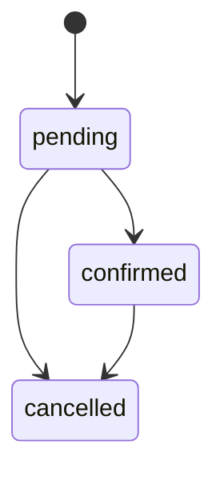
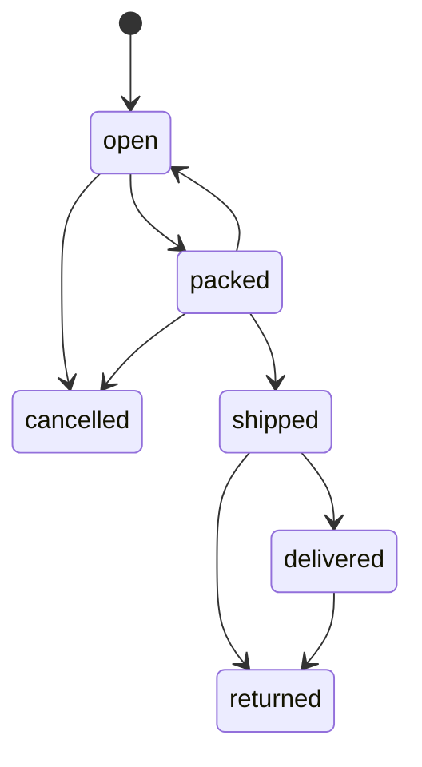

> ESD design er ongsho · [Suchipotro ar version](README.md) · Shob kaj e age: Section 1.4 ([01-overview.md](01-overview.md))

Section 8 er ongsho (v1.32: [08-core-flows.md](08-core-flows.md) 60 KB er kache, tai 8.5–8.10 ar M6 er decision 8.19 ekhane; section number ekoi). 8 er shuru, 8.1–8.4 ar 8.11–8.18: [08-core-flows.md](08-core-flows.md). Code file: [`pricing`](../../backend/internal/pricing/pricing.go), [`order`](../../backend/internal/order/order.go).

### 8.5 Dam er hishab (`pricing` package)

Shob hishab ekta pure package e. Checkout, quote, order edit, packing, shob jaygay **ei function gulo-i** use hobe, onno kothao alada hishab likhbe na.

| Function | Kokhon | Ki dey |
|---|---|---|
| `Calculate` | Quote, checkout | Order er taka, protiti line er `discount_share`, protiti vendor er taka (fulfillment). Bhul input e `ErrInvalidInput` (v1.3; v1.5: fixed line e `WeightG` 0). v1.7: coupon na khatle (eligible subtotal 0 ba `min_order` er kom) `ErrCouponNotApplicable` |
| `Reprice` | Packing e asol ojon (`Edit = false`), order edit (`Edit = true`) | Notun hishab, prepaid hole refund er poriman. Line er shonkhya na mille `ErrLineCount`; snapshot theke dam ba vendor bodlale, qty barale ba edit e ojon barale `ErrInvalidInput`. v1.4: je vendor er line bodlay nai tar taka hubohu ager; coupon ashe order er snapshot theke, ager discount thakle coupon nil e `ErrInvalidInput`. v1.5: fixed line e `WeightG` 0, ar Original er line, fulfillment ar order er taka nijeder moddhe na mille (COD te line total = `LineTotal`, Qty 0 er line e 0) `ErrInvalidInput` |
| `Commission` | Checkout (marketplace) | Line er commission. Single store e `commission_bps = 0`, tai 0 |
| `Allocate` | Uporer gulor bhetore | Ekta taka ke onupat onujayi bhag; bhag gulor jog thik mot er shoman |
| `LineFromItem`, `EditWeightG` (v1.5) | Packing, edit | `order_items` er row theke `Line` ar ager `LineResult` (removed hole Qty 0, ojon-variable e packed ba ordered ojon, fixed e 0); edit e qty komale notun ojon onupate |

Bhag er niyom: discount eligible line gulor moddhe line total onujayi; delivery charge (`per_order` mode e) vendor gulor moddhe subtotal onujayi. Bhag "largest remainder" niyome, tai jog shob shomoy mot er shoman, ek poisha o hariye jay na. Single store e vendor ekta, tai fulfillment er taka = order er taka, ar result v1.0 er hubohu.

Ojon-variable line e `WeightG` holo **puro line er mot ojon** (order e `nominal_weight_g × qty`, packing e asol mot ojon). `Qty` diye abar gun hoy na. `nominal_weight_g` NULL hole `WeightG` 0 hoy, ar `Calculate` error dey (v1.2 e line ta free hoye jeto).

Order edit e (`Edit = true`) fixed coupon er discount eligible subtotal er onupate kome: ৳900 + ৳100 er order e ৳100 coupon thakle ৳900 er item bad dile ৳100 er item ৳10 discount pay, free hoy na. Min_order er "cliff" nai, tai prepaid e kichu bad dileo total bare na. Packing e (`Edit = false`) ager niyom: ojon komle fixed discount puro thake. Edit e quantity ba ojon barano jay na (notun order), `Reprice` nijei atkay.

v1.4: **Onno vendor er taka freeze.** Ager version e `Reprice` puro order er discount abar shob line e bhag korto, tai marketplace e ek vendor er packing onno vendor er fulfillment er total bodlato (B ship hoye gele `cod_amount` ar total mile na, pore ledger o). Ekhon je vendor er kono line bodlay nai (`Qty`, `WeightG` ager moto), tar line total, `discount_share` ar delivery hubohu ager. Bodla vendor gulo uporer niyom e chole, kintu shudhu nijeder bhag e: fixed coupon e tader nijeder ager discount (packing e eligible er beshi na, edit e onupate); percent coupon e order er percent discount (cap shoho) jotota bodlay, tara thik totota pay (delta). Absolute hishab (notun percent theke frozen bhag bad) korle rounding e frozen bhag ek poisha beshi thakte pare, ar ditiyo dhape prepaid customer ek poisha beshi dito; delta niyome eta hoy na. Single store e vendor ekta, tai result v1.3 er hubohu (200,000 random case e milano; duita ichchhakrito bytikrom niche, v1.5). Delivery 0 hoy shudhu jodi oi vendor er shob line bad (`Qty` 0); ৳0 er line (free gift) baki thakle delivery thake.

v1.4: **Coupon er shorto snapshot.** `Reprice` er `Coupon` ashe `orders.coupon_*` theke (checkout e copy, 8.6 step 15), `coupons` table theke na: admin pore coupon edit ba bondho korleo purono order er packing/edit er hishab bodlay na. Ager discount ache kintu `Coupon` nil hole `ErrInvalidInput` (ager version e prepaid order e kichu na bodlei total ৳900 → ৳1,000 hoye jeto). Marketplace commission o `order_items.commission_bps` (order er shomoyer rate) diye, `vendors.commission_bps` diye na.

v1.5: **`order_items` theke line.** Packing ar edit er `Original` ar notun line shudhu `LineFromItem` diye. `status = 'removed'` er item DB te ager `quantity` niye thake (CHECK `> 0`), kintu hishab e `Qty` 0 ar `WeightG` 0. Ojon-variable e `WeightG` = `packed_weight_g`, na thakle `ordered_weight_g`; fixed line e `WeightG` 0 (`order_items_weight_check` e fixed item e ojon-i thake na). Item ojon-variable kina ashe `order_items.variable_weight` (snapshot) theke, `products` theke na. Edit e ojon-variable line er qty komale notun `ordered_weight_g = EditWeightG(ordered_weight_g, purono qty, notun qty)` (onupate, niche round, kom-poksha 1 gram). Ager version e removed item ke `quantity` diye pathale COD te oi vendor er porer packing e item ta abar bill e jog hoto, kono error chhara; ekhon `Reprice` er Original check eta atkay, ar DB te removed item er taka 0 (`order_items_removed_zero_check`).

v1.5: **Fixed line e `WeightG` 0.** Fixed line er dame ojon lage na, kintu `Reprice` vendor bodleche kina `WeightG` diyeo dekhe: kono caller fixed line e ojon dile vendor bhul kore bodla dhora porto ar freeze bhangto. Ekhon `Calculate` ar `Reprice` duitai fixed line e `WeightG != 0` hole `ErrInvalidInput`.

v1.5: **Original er check.** `Original` database theke ashe, jekhane cross-row CHECK nai. `Reprice` age dekhe: protiti line er discount er bhag 0 theke line total porjonto, Qty 0 er line e taka 0, COD te line total = `LineTotal(line)` (prepaid e tar beshi na, cap), protiti vendor er ekta-i fulfillment ar tar subtotal/discount line er jog, ar order er taka fulfillment er jog. Na mille `ErrInvalidInput` (ROLLBACK ar log), chupchap hishab na.

Jana shima (v1.4 freeze er fol): bodla vendor er discount tar notun eligible er beshi hoy na, ar frozen vendor er bhag bodlay na. Tai A ৳5,000 ar B ৳5,000, 10% coupon (cap ৳100) e bhag ৳50 + ৳50; edit e A er ৳10 baki rakhle A er discount ৳10, mot ৳60, jodio baki item e notun hishab ৳100 dito. Prepaid e total kokhono bare na, kintu eta customer er khoti; Phase 3 er age thik koro (16.1). Checkout e discount 0 hole (rounding) `Reprice` e-o 0 thake, ojon barleo.

Single store e v1.5 er result v1.3 er hubohu, duita ichchhakrito bytikrom chhara: ৳0 er line baki thaka vendor er delivery thake (v1.3 e 0), ar ager discount thakle coupon snapshot chhara error (v1.3 e chupchap discount 0). 400,000 random case (qty ardhek komano shoho) e milano.

Code: [`backend/internal/pricing/pricing.go`](../../backend/internal/pricing/pricing.go).

Unit test: v1.0 er shob case ager result-i dey; tar shathe marketplace, `Reprice` (packing ar edit), commission, ar 20,000 random input e (prepaid/COD × packing/edit) niyom gulo kokhono bhange na (bhag er jog, prepaid e customer beshi dey na). v1.4: dui dhap `Reprice`, kichu na bodlale hubohu ager result, je vendor bodlay nai tar taka freeze, shima (free delivery `>=`, half-up rounding) ar protiti input guard er test; mutation test e (19 ta bhul) shob dhora pore. v1.7: `TestCouponNotApplicable` (`TestCalculate` er "min order not met" ar "vendor coupon min_order" case ekhane; error ar coupon chhara total duitai dekhe, shima shoho) ar `TestRepriceEditThenPackRandom` (asol kram: edit, tarpor vendor onujayi pack; protiti dhap `LineFromItem` diye row theke; 20,000 order, review e 40 seed × 50,000 o chalano, kono niyom bhange ni). Test: [`pricing_test.go`](../../backend/internal/pricing/pricing_test.go).

Aro niyom: coupon er `min_order` na mille checkout `409 coupon_invalid` dibe (chupchap 0 discount na). v1.7: eta ashe `Calculate` er `ErrCouponNotApplicable` theke, caller nije eligible subtotal hishab kore na (Rule 1); coupon er eligible line er subtotal 0 hole-o (vendor coupon er vendor er line cart e nai, ba shudhu ৳0 er line) ekoi error. Ager version e emon order discount 0 diye hoto, kintu 8.6 step 11 er `used_count + 1` ar redemption customer er `per_phone_limit` khete. Quote e coupon chhara abar `Calculate` kore total dekhao, shathe `coupon_invalid`. Delivery zone er `min_order` (discount er porer taka) na mille `409 below_min_order`. Free delivery: discount er porer taka `free_delivery_over` er shoman ba beshi hole (`>=`). Vendor coupon (`coupons.vendor_id`) er `min_order` shudhu oi vendor er line er upor. `per_vendor` mode e free delivery shima puro order er upor dekha hoy; shima chhuyle shob parcel free. Jana shima (Phase 3 er age thik koro): `per_order` mode e ek vendor er shob line bad hole tar delivery er bhag 0 hoy, baki vendor der moddhe abar bhag hoy na, tai order er delivery charge kome.

### 8.6 Checkout: `POST /api/orders`

Ei order e kaj korbe. Ekta step fail korle porer step e jabe na.

**Transaction er age:**

1. `Idempotency-Key` header check (max 64 okkhor). Na thakle `400`. `idempotency_hash` = shudhu request body er canonical JSON er `sha256`: customer, recipient, address, note, `coupon_code`, `payment_method`, `expected_total`, `consent`. `turnstile_token`, `otp_code` ar `website` hash e na, karon retry te egulo bodlay; thakle response harano retry `422` pay ar customer notun key e duplicate order kore. v1.4: server er cart-o hash e na: order hole step 17 e cart khali hoy, tai response harano retry te cart er list alada hoye `422` ashto (v1.3 er bug). Cart er dam-shoho mot `expected_total` e dhora thake, tai `expected_total` badhyotamulok, na thakle `400 validation_failed`.
2. Ei key diye age order hoye thakle: hash mile → sheta-i ferot dao (`200`), notun kichu na; hash na mille `422 idempotency_key_reused`. Eta Turnstile er **age**, karon retry te Turnstile token already use hoye geche.
3. Honeypot field (`website`) khali na thakle `400`. `otp_code` na thakle Turnstile token Cloudflare er siteverify te check (token ekbar-i cholbe). `otp_code` thakle Turnstile lage na (prothom request e check hoyeche, ar OTP pathano hoy shudhu Turnstile pass korle), kintu tokhon `otp_code` **shob shomoy** verify hoy (step 8), OTP lagbe kina tar upor nirbhor na; bhul hole `400 otp_invalid`. Na hole bot je kono `otp_code` diye Turnstile edate parto.
4. `consent` na thakle `400`. Customer ar recipient er phone normalize, naam/thikana validate.
5. Delivery zone khojo: age `(district, area)` mile emon, na pele `(district, area IS NULL)`. Na pele `409 area_not_served`.
6. Customer **ba** recipient er phone `blocked_phones` e thakle ar payment COD hole `403 phone_blocked` (online payment allowed).
7. Cart load. Khali hole `400 cart_empty`. Product ba variant bondho hole `409 out_of_stock`, item er vendor `active` na hole `409 vendor_unavailable` (marketplace).
8. Risk flag hishab (8.7, client IP 3.2). v1.7: flag er "total" holo `expected_total` (step 1 e badhyotamulok): asol hishab step 12 e, ar shekhane na mille `409 price_changed`, tai ekhane alada `Calculate` lage na, ar client er total diye shudhu flag hoy, dam na (Rule 1). OTP lagle ar `otp_code` na thakle: checkout OTP pathao, `409 otp_required`. `otp_code` thakle (OTP lagbe kina dekhar age-i) verify (8.2 er moto, purpose `checkout`): attempt gona ar hash tulona; thik hole `otp_verified = true`. v1.7: ekhane consume **na**, OTP er `id` rakho (step 9 e consume).

**Transaction (`BEGIN ... COMMIT`, `READ COMMITTED`):**

9. `pg_advisory_xact_lock` (shop + key) niye abar key check (6.4). Pele `ROLLBACK`, step 2 er moto uttor. Ekoi key er duita request ek shathe ashleo ekta-i order, ar duplicate ta bhul `409` pay na. v1.7: tarpor `otp_code` thakle OTP consume: `UPDATE otp_codes SET consumed_at = now() WHERE id = $1 AND consumed_at IS NULL RETURNING id`; kichu na ele `ROLLBACK`, `400 otp_invalid` (onno key er order e code ta already use hoyeche). Porer kono step fail korle (`price_changed`, `out_of_stock`, `coupon_limit_reached`) ROLLBACK e OTP abar use kora jay, tai customer notun OTP ar notun Turnstile chhara-i abar submit kore; ager version e step 8 e consume hoto, ar `price_changed` er por OTP box atke jeto. OTP row onno kono flow er lock er sathe joray na, tai lock er kram e prova nai.
10. Item gulo `variant_id` onujayi **sajiye** (deadlock thekate) protitir jonno atomic stock komano (6.4, product o active). Kono ekta 0 row hole `ROLLBACK`, `409 out_of_stock` (kon variant sheta `details` e). Test e sort chhara ulto kram er 20 ta checkout e 15 ta deadlock hoyeche, sort kore 0. Ek transaction e ekadhik variant chhoy emon shob code (cancel e restock, edit, return, adjust) ekoi kram e sajabe.
11. Coupon thakle: **age** atomic `used_count + 1` (6.4, coupon row lock hoy), **tarpor** phone er redemption count `per_phone_limit` er kom kina. Kono ta na mille `ROLLBACK`, `409 coupon_invalid` ba `coupon_limit_reached`.
12. `pricing.Calculate` diye total, line er `discount_share` ar vendor onujayi taka (`marketplace.delivery_charge_mode`, default `per_order`). Marketplace e line er `commission` (`pricing.Commission`, vendor er `commission_bps`). Zone `min_order` check. `expected_total` (badhyotamulok, step 1) na mille: `ROLLBACK`, `409 price_changed`. `Calculate` `ErrCouponNotApplicable` dile (v1.7) `ROLLBACK`, `409 coupon_invalid` (step 11 er `used_count` o ferot); onno error dile (input bhul, mane code er bug) `ROLLBACK`, `500`, log.
13. Order number (`shop_counters`; `shops.order_prefix` + `-` + `100000 + value`), transaction er shesher dike, karon counter row er lock commit porjonto thake. `public_token = rand.Text()`, `delivery_deadline = now + (same_city ? 5 : 10) din`.
14. Status: COD te confirmation lagle `pending`, na lagle shorasori `confirmed`. Online payment e `pending` ar `payment_status = 'pending'`. `display_status = order.Summary(status, nil)`: fulfillment ekhono insert hoyni, ar khali `fs` e `Summary` `confirmed` dey (order test er "checkout step 14" case).
15. `orders` insert (`ON CONFLICT (shop_id, idempotency_key) DO NOTHING`). Kichu ferot na ele `ROLLBACK` kore ager order ferot dao. v1.4: coupon thakle shathe tar shorto (`coupon_code`, `coupon_kind`, `coupon_value`, `coupon_max_discount`, `coupon_vendor_id`, `coupon_funded_by`, step 11 er `RETURNING` theke); COD confirmation lagle `confirm_token_hash` (8.10).
16. Protiti vendor er jonno ekta `order_fulfillments` row (`seq` 1, 2, ...; `status = 'open'`; `Calculate` er oi vendor er taka). Single store e ekta-i. Tarpor `order_items` (vendor, fulfillment, naam, variant label, sku, dam, kena dam er snapshot, `discount_share`, `commission`, vendor er `commission_bps`; v1.5: `variable_weight` snapshot, ojon-variable hole `ordered_weight_g` = `nominal_weight_g × qty`, fixed hole ojon NULL), `inventory_movements` (`reason = 'order'`, `change = -qty`), `order_status_history`, `coupon_redemptions`.
17. Cart khali.
18. Job: `sms.order_placed` (confirmation lagle confirm link shoho; link 8.10 er `confirm_token`, job payload e shudhu `order_id`), `alert.new_order`. COD pending hole `order.auto_cancel_unconfirmed` (setting er ghonta por, default 24). Online hole `order.auto_cancel_unpaid` (30 minute por; cancel er age reconcile, 8.9).

Deadlock (`40P01`) ba serialization (`40001`) error hole puro transaction ekbar abar chalao.

**Transaction er por:**

19. Online payment hole payment row banao ar SSLCommerz session (8.9). Fail hole order thakbe, `payment_url: null` ar customer `/pay` diye abar cheshta korte parbe.

v1.32 (M6, user 15 November 2026): `Idempotency-Key` er format ar hash er encoding, onno user er key, `price_changed`/`out_of_stock` er `details`, field er limit (step 4), login ar guest er OTP (step 3, 8), zone lookup (step 5), coupon er error (step 11), rate limit (7.8) ar job er `RunAt` (step 18): 8.19.

### 8.7 Risk ar OTP

Settings e `checkout.otp_mode`: `never`, `risky`, `all_cod`, `all`.

| Flag | Kokhon |
|---|---|
| `cod_high_amount` | COD ar total `checkout.risk.cod_amount_over` er beshi (default ৳3,000 = `300000`) |
| `phone_refused_before` | Ei phone er age kono fulfillment `returned` (customer nite chayni) |
| `many_orders` | Ek phone ba ek client IP (3.2) theke ek ghontay 3 ba beshi order |
| `new_phone_high_amount` | Ei phone er prothom order ar total `checkout.risk.new_phone_amount_over` er beshi |

v1.7: flag er "total" holo checkout er `expected_total` (8.6 step 8); step 12 e mile na hole order-i hoy na.

| `otp_mode` | OTP lagbe |
|---|---|
| `never` | Kokhono na |
| `risky` | Kono flag thakle (online payment e na) |
| `all_cod` | Shob COD order e |
| `all` | Shob order e |

Flag gulo `orders.risk_flags` e save hoy, admin order er pashe dekhte pay. COD confirmation er setting alada: `checkout.cod_confirmation` = `none`, `risky`, `all`.

v1.32 (M6, user 15 November 2026): protiti flag er shothik query (shomoy, kon phone, cancelled gona), OTP kon phone e, login customer, ar `cod_confirmation = risky` er mane: 8.19 item 3, 4.

### 8.8 Order ar fulfillment er status (state machine)

Duita state machine (3.7). Order er ta customer ar payment er, fulfillment er ta ek vendor er pack-ship er.

Order:

Fulfillment (order `confirmed` hoyar por-i `packed` e jete pare):

v1.37 (16.1, Claude decide, user bodlate paren): `packed → open` (undo pack) shudhu COD, active shipment chhara, `note` badhyotamulok. Prepaid M10 e abar dekha.

Code: [`backend/internal/order/order.go`](../../backend/internal/order/order.go), test [`order_test.go`](../../backend/internal/order/order_test.go) (golden table shoho).

Customer ar admin ekta status dekhe: `orders.display_status = order.Summary(order.status, fulfillment status gulo)`. Single store e eta v1.0 er status er hubohu; marketplace e vendor gulo alada stage e thakle `partial`.

Status bodlano **shudhu duita function** diye: `TransitionOrder(ctx, tx, shopID, orderID, to, by By, note)` ar `TransitionFulfillment(ctx, tx, shopID, fulfillmentID, to, by By, note)` (v1.34: `shopID` Rule 3, `By{Actor, ID, VendorID}` history er `actor_id` ar vendor er nijer fulfillment, 8.19 item 13). Duitai age order row, tarpor fulfillment row `SELECT ... FOR UPDATE` kore, `CanTransitionOrder` (order er `Payment{Method, Paid}` shoho) ba `CanTransitionFulfillment` check kore (na hole `409 invalid_transition`; online order unpaid hole `409 payment_required`), side effect kore, `order_status_history` e likhe (`fulfillment_id` shoho), ar `display_status` abar hishab kore. Fulfillment `packed` korte order `confirmed` thakte hobe. Vendor actor shudhu nijer `vendor_id` er fulfillment chhute pare. **Upore cascade**: `TransitionFulfillment` e shob fulfillment cancelled hole (`AllCancelled`) ek-i transaction e `TransitionOrder(confirmed → cancelled, System)`, tarpor `Summary`. **Niche cascade** (v1.3): `TransitionOrder(→ cancelled)` `order.CancelCascade(fs)` er open/packed fulfillment gulo ek-i transaction e cancel kore, fulfillment cancel er side effect shoho, history te order er actor diye. Actor er onumoti `CanTransitionOrder` age-i dekheche (customer: shob open/cancelled; staff: packed o; system: pending order, ba `AllCancelled`). Ei cascade `TransitionFulfillment` dake na, tai upore abar `TransitionOrder` ashe na. Onno kothao `UPDATE ... SET status` likhbe na. Lock er kram shob code e ek: order → payment → fulfillment → variant (sajano) → coupon → counter. v1.34: cancel e batch (`inventory_batches`) variant er por, `id` er kram e `FOR UPDATE`.

Single store e "Packed", "Shipped" button order page ei thake; backend oi order er ekmatro fulfillment e `TransitionFulfillment` dake.

| Bodol | Side effect |
|---|---|
| Order `pending → confirmed` | `confirmed_at`. COD: confirm link (customer, 8.10 er `confirm_token`) ba phone call (staff). Online: shudhu `payment_status = 'paid'` er por, validation (system) ba staff (gateway e nije dekhe). DB CHECK o atkay |
| Order `→ cancelled` | `CancelCascade` er open/packed fulfillment gulo `cancelled` (niche er side effect shoho; refund oikhane-i, order level e alada refund row **na**), coupon redemption muche `used_count = GREATEST(used_count - 1, 0)` (v1.7: admin `used_count` komale `CHECK` e puro cancel atke jeto), SMS |
| Fulfillment `open → packed` | Shob item pack, ojon-variable item er asol ojon ar `pricing.Reprice`, FIFO batch allocation (8.11), `packed_at` |
| Fulfillment `packed → open` (v1.37, undo pack) | Ek tx e `TransitionFulfillment`: lock order → fulfillment → variant (sorted) → batch (id kram e). Protiti `order_item_batches` row er quantity `quantity_remaining` e ferot, row muche (`variant.stock` bodlay na: checkout e newa, 8.12 er rater check thik thake). Taka: clear er age `LineFromItem` diye `Original`, `packed_weight_g = NULL`, `Reprice(Edit = false)` order er ojon e, line/fulfillment/order total save (lagbe, na hole porer edit er `Original` check fail). `packed_at = NULL`, note shoho history, `display_status` abar hishab; SMS na. Guard: COD na → `409 invalid_transition`; returned na emon shipment thakle `409 invalid_transition`; khali note → `400 validation_failed`. Ke: owner, admin, staff, ar nijer fulfillment e vendor_owner/vendor_staff (pack er moto). M7 code: `order.go` er transition table e `Packed` e `Open: {Staff, Vendor}`. M7 test: golden row; duita FIFO batch e pack tarpor undo → batch hubohu ferot, `order_item_batches` khali, `packed_weight_g` NULL, total pack er ager shoman, history te note; abar pack e FIFO + rater check green; prepaid → `409`; active shipment → `409`; `shipped → open` → `409`; khali note → `400`; onno vendor er fulfillment → `404` |
| Fulfillment `packed → shipped` | Shipment row lagbe (COD hole `cod_amount` = fulfillment er `total`). `shipped_at`, tracking shoho SMS. v1.41: shipment ar transition ek call/tx e (11.7 item 5) |
| Fulfillment `shipped → delivered` | `delivered_at`, review link SMS. COD order er shob active fulfillment delivered hole `payment_status = 'paid'` (courier er taka pore COD settlement e mile). v1.41: `PATCH /shipments/{id}` `delivered` theke; taka M11 porjonto rider/courier er hate; delivered SMS M9 e (11.7 item 5). v1.43: shudhu oi PATCH e (active shipment delivered); "shob active" = open/packed/shipped keu nai ar kom-poksha ekta delivered |
| Fulfillment `→ cancelled` | Oi fulfillment er stock ferot (`inventory_movements` `cancel`), pack hoye thakle batch ferot (`order_item_batches` theke), prepaid hole oi fulfillment er **bortoman** `total` refund (`refunds.kind = 'cancel'`, `fulfillment_id`; DB te ekbar-i, `refunds_cancel_once`); v1.5: total 0 hole refund row hoy na (edit e `Reprice` already ferot diyeche, 8.11). Refund er age order row lock, tarpor mot refund (failed bad) ≤ paid check. Shob fulfillment cancelled hole order o `cancelled` (system, `AllCancelled`). v1.7: shop er `staff` role fulfillment cancel korte pare na, order cancel er moto (11.2): `403 forbidden` |
| Fulfillment `shipped/delivered → returned` | Staff bachai: stock e ferot (non-perishable) ba `wastage`. Prepaid hole, ba COD te taka newa hoye thakle, refund. Courier parcel ferot dile age shipment `returned`; staff abar pathale notun shipment (fulfillment `shipped` e thake), na pathale fulfillment `returned`. v1.7: refund hobe emon return shudhu owner/admin; `staff` role shudhu refund chhara return (COD, taka newa hoyni). v1.41: item onujayi `restock_item_ids`, refund `min(total, paid − ager refund)` (11.7 item 6). v1.43: active shipment thakle `409`; COD e refund shudhu `delivered → returned` e, method `cash` |

v1.32 (M6, user 15 November 2026): M6 e `TransitionFulfillment` shudhu `→ cancelled` er side effect kore; baki bodol M7 porjonto `ErrNotImplemented` (8.19 item 8). v1.41: M7a te baki path (`open`, `packed`, `shipped`, `delivered`, `returned`); restock e expire batch er niyom 11.7 item 3.

### 8.9 SSLCommerz payment

**Shuru:**

1. Ei order er ager `initiated` payment gulo `cancelled` (`/pay` retry). Notun `payments` row: `tran_id = rand.Text()` (random; order number shudhu shop er bhetore unique, tai multi-tenant e duita shop er number mile jete pare), `amount = order.total`, `status = 'initiated'`, `reconcile_after = now + 15 minute` (v1.4). Eta shudhu local status: oi purono `tran_id` e pore VALID IPN ele-o niche-r validation mane.
2. Session API te POST (form): `store_id`, `store_passwd` (shop_credentials theke, sandbox/live o oikhane), `total_amount` (poisha theke taka, 2 doshomik: `20400` → `"204.00"`), `currency=BDT`, `tran_id`, `success_url`, `fail_url`, `cancel_url`, `ipn_url`. SSLCommerz e mandatory: `cus_name`, `cus_email` (customer na dile shop er `branding.email`), `cus_add1`, `cus_city` (district), `cus_postcode` (na thakle district er default), `cus_country`, `cus_phone`, `shipping_method`, ar product er naam, category, profile.
3. Response er `GatewayPageURL` e customer ke redirect.

**Validation** (IPN `POST /api/payments/sslcommerz/ipn` ar success return, duitai ekoi function, idempotent; shobcheye guruttopurno):

1. Form theke `tran_id`, `val_id` nao. `tran_id` diye payment khojo; sekhan thekei shop (IPN e `X-Shop-Host` thake na) ar oi shop er credential. Na pele `404`, log. v1.7: form er `status` `VALID`/`VALIDATED` na hole ba `val_id` khali hole Validation API call na, payment row bodlay na: shudhu log (IPN e `200`, return e redirect).
2. Transaction e age oi order row, tarpor payment row `SELECT ... FOR UPDATE` (lock er kram 8.8: order → payment; ulto korle `/pay` ba auto-cancel er sathe deadlock). Already `succeeded` hole `200` (abar kichu korbe na). Local status `cancelled` ba `failed` holeo (purono tab, `/pay` retry) validation chalao: gateway VALID bolle sheta-i shotti.
3. Order Validation API call: `val_id`, `store_id`, `store_passwd`, `format=json`. Timeout ba 5xx hole payment `failed` **na**, `500` ferot (SSLCommerz IPN abar pathay, reconcile o dhore).
4. Response e `status` `VALID` ba `VALIDATED`, `tran_id` mile, `amount` payment er amount er shoman (taka string ke float chhara poisha te parse: `"204.00"` → `20400`), `currency` `BDT`, ar `currency_type` `BDT` o `currency_amount` o shoman (BDT store e ek-i thake). v1.7: shudhu `VALID`/`VALIDATED` ar `tran_id` mile kintu amount ba currency mile na hole payment `failed`, `reconcile_after = NULL` (v1.5: mismatch barbar reconcile hoye alert na dey), alert, order confirm na. Response `VALID` na hole (`INVALID_TRANSACTION`, `FAILED` ...) ba response er `tran_id` form er sathe na mille payment row bodlay na: shudhu log (`tran_id` mismatch e alert), `reconcile_after` jemon chhilo. Karon return URL unauthenticated (CrossOriginProtection bypass, 4.2): ager niyome `tran_id` jana je keu bhul `val_id` ba nijer onno payment er `val_id` diye payment `failed` ar reconcile bondho korte parto, ar failed attempt er por ekoi session e pay korle IPN harale auto-cancel er ekbarer reconcile er por keu dhorto na (v1.4 er late payment er bug ferot ashto).
5. Transaction e: payment `succeeded`, `val_id`, `bank_tran_id`, `risk_level`, `store_amount` (fee kete, settlement mela), `raw`, `reconcile_after = NULL`; order `payment_status = 'paid'` (age), tarpor `TransitionOrder(pending → confirmed, system)`; `sms.paid` job. `risk_level = 1` hole payment succeeded, kintu order confirm na kore staff review alert.
6. Order already `cancelled` (30 minute por auto-cancel ba customer) hoye thakle: payment succeeded rakho, order cancel e thakbe, refund row (`pending`, `kind = 'late_payment'`) ar admin alert.
7. Order already paid (duita tab ba `/pay` retry te duita payment): ei payment succeeded, auto refund row (`pending`, `kind = 'duplicate'`), admin alert. Kokhono error ferot dibe na, na hole SSLCommerz IPN barbar pathabe.

**Return URL**: `success` e upore validation function chaliye `303` diye website er `/order/{token}/done` e; `fail`/`cancel` shudhu redirect. Browser er pathano status kokhono paid kore na. Done page API theke status dekhay (validation dheri hole kichukkhon "payment check hocche").

**Reconcile** (v1.4): `payment.reconcile` job protiti 10 minute e `reconcile_after <= now()` emon payment nay. Eta shudhu `initiated` na: `/pay` retry te local `cancelled` hoya purono tab er payment o, karon gateway te oi session tokhono jibonto. Ager version shudhu `initiated` dekhto, tai customer purono tab e pay korle ar IPN harale taka katto, kintu order auto-cancel hoto ar refund row-o hoto na. Protitir jonno Transaction Query API (`tran_id`); success pele upore validation (order cancel hoye thakle step 6 er `late_payment` refund). Na hole `reconcile_after` porer dhape: toiri howar 15 minute, 1 ghonta, 6 ghonta ar 24 ghonta por; tarpor `NULL`. `order.auto_cancel_unpaid` cancel er age oi order er `succeeded` na shob payment ekbar reconcile kore. IPN path e Cloudflare WAF custom rule er skip dao. **Bot Fight Mode (free plan) skip kora jay na**: WAF custom rule ba Page Rule kono tai kaj kore na, eta puro domain e chole, ar API ba app traffic-o challenge korte pare. Tai free plan e Bot Fight Mode off rakho (Turnstile ar rate limit ache), ba Pro plan e Super Bot Fight Mode chalao ar IPN path skip koro, ba SSLCommerz er IPN IP er jonno IP Access allow rule dao (age match korle Bot Fight Mode chole na).

**Escrow**: Bangladesh Bank er 2021 er niyom e gateway delivery confirm er por merchant ke taka dite pare (12.1). Ei shop er settlement kivabe hobe SSLCommerz er sathe confirm koro; delivery confirmation pathate hole `delivered` er por job (Phase 2 API).

Refund MVP te SSLCommerz merchant panel theke kore admin e record (`refunds`, `provider_ref`), Phase 2 te refund API (`bank_tran_id` lage).

Marketplace e payment shop er (platform er) SSLCommerz account e ashe; vendor ra taka pay payout e (8.18). Multi-tenant e protiti shop er nijer SSLCommerz account (`shop_credentials`).

### 8.10 COD confirmation

1. v1.4: confirm er jonno alada token. `public_token` order-dewa browser pay (`201` response, `/order/{token}/done`), tai tar diye confirm hole onner number diye fake order dewa manush nijei confirm korte parto, SMS er phone chhara-i. Ekhon `confirm_token = base32(HMAC-SHA256(CONFIRM_SECRET, "cod-confirm:" + public_token))` er prothom 26 okkhor (130 bit). Checkout (8.6 step 15) e shudhu `orders.confirm_token_hash = sha256(confirm_token)` boshe. Token kono API response e jay na, database e o plain text e na: `sms.order_placed` job er payload e shudhu `order_id`, worker `public_token` theke token abar banay, tai retry te ekoi link.
2. SMS e link: `https://<domain>/confirm/<confirm_token>`. Page `GET /api/confirm/{confirm_token}` theke order er shar-songkhep (phone/thikana mask) ar "Order confirm korun" button. Button `POST /api/confirm/{confirm_token}` → `TransitionOrder(pending → confirmed, customer)`. Token hash er age uppercase (link e case bodlaleo chole); na mille `404`. Online order e token toiri-i hoy na (DB CHECK `orders_confirm_token_cod_check`).
3. Staff phone kore-o confirm korte pare (`TransitionOrder(..., staff, "phone e confirm")`).
4. Setting er ghonta por-o `pending` thakle `order.auto_cancel_unconfirmed` job cancel kore.
5. `/order/{token}` ar done page e confirm button nai, shudhu "SMS er link e confirm korun". v1.7 (ager lekha bhul chhilo): verify hoy `sha256(token)` diye lookup kore, secret lage na, tai `CONFIRM_SECRET` rotate korleo ager pathano link kaj kore. Je ta bhange: rotate er por pending order er SMS retry ba resend, karon worker notun secret e notun token banay ja `confirm_token_hash` er sathe mile na (`404`). Tai rotate er shomoy ek transaction e pending COD order gulor `confirm_token_hash` notun secret diye abar likho (`public_token` theke). Kono link bondho korte chaile oi order er hash bodlao, ba `NULL` kore staff phone e confirm (step 3).
6. v1.32 (M6, user 15 November 2026): confirm SMS er template alada key `sms.order_confirm`, link e shop er primary domain (8.19 item 7).

### 8.19 M6 er decision (v1.32)

User 15 November 2026 e M6 plan er shob recommendation niyeche ([M6](../milestones/M6.md) Q1–Q13). Ekhane backend er niyom; API er path 7.2, 7.3, 7.5, 7.8 e, website 10.13 e.

1. **File bhag** (Q1): 8.5–8.10 ar 8.19 ei file e, baki Section 8 [08-core-flows.md](08-core-flows.md) e; section number ekoi. Itihash er "v1.x:" lekha thake (design er audit trail).
2. **Delivery zone** (Q2, 7.2, 8.6 step 5): M6 e zone shudhu local/test seed (`scripts/dev-seed.sql` ba `make seed`: Dhaka er kichu area + "Dhaka" district `area NULL`; test e helper); production er zone M7 er admin (7.7) e, launch M7 er age na. `GET /api/delivery-zones` → `[{district, areas: [{area, name, days}], district_wide: bool, district_wide_days: int|null}]`, shudhu `is_active`; v1.35: `days` = 8.15 er `delivery_deadline` er din (`same_city` 5, na hole 10; `shipping.DeadlineDays`, order eo ekoi function), form e area (ba "Onno area") bachlei `checkout.delivery_time` dekhay (10.6, 12.2). Form e district er zone er area dropdown; district e `area NULL` zone thakle "Onno area" + free text (`ship_area` badhyotamulok, max 100), lookup oi district-wide zone e. District/area er string zone er `district`/`area` er hubohu (Bangla/English naam `name` JSONB theke dekhano). `POST /api/delivery/quote` M6 e na: checkout quote-i jothesto (Phase 2 te product page er delivery estimate).
3. **Risk flag** (Q3, 8.7): `many_orders`: shesh 60 minute e ei shop e ekoi `customer_phone` **ba** ekoi `ip` er ager order (shob status) `>= checkout.risk.max_orders_per_hour - 1` (mane ei ta 3 tomo; default 3). `phone_refused_before`: `customer_phone` ba `recipient_phone` er kono ager order er fulfillment `returned`. `new_phone_high_amount`: `customer_phone` er ager kono order nai (cancelled o gona) ar `expected_total > new_phone_amount_over`. `cod_high_amount`: COD ar `expected_total > cod_amount_over` (`>`, shoman na). Query `orders_phone_idx`/`orders_placed_idx` e. Cancelled o gona, karon bot er barbar cheshta dhore.
4. **Checkout OTP** (Q4, 8.6 step 3, 8): OTP `customer.phone` e (recipient e na). Login customer er `customer.phone` = account er phone (form e readonly; body te onno phone `400 validation_failed`), tai OTP lage na, `otp_verified = true`, `user_id` boshe; onno phone er order chaile logout kore guest. Guest e OTP lagle `409 otp_required` + `details {phone_masked}` → form er OTP box → ekoi body + `otp_code` (Turnstile chhara); resend = `otp_code` chhara abar submit (notun Turnstile; 7.8 er send limit ar `sms_daily_cap` ekoi gona). `checkout.cod_confirmation`: `risky` = kono flag **ar** `otp_verified = false` (OTP e phone proman hole confirm SMS lage na); `all` = shob COD; `none` = kokhono na.
5. **Coupon** (Q5, 8.13, 6.4): code `trim` + `upper`, khali string = coupon nai, max 32 okkhor. Step 11 er atomic `UPDATE` 0 row dile ekta `SELECT` diye karon: code nai, `is_active = false` ba shomoy er baire → `409 coupon_invalid`; `usage_limit` shesh → `409 coupon_limit_reached`; `per_phone_limit` (phone = `customer_phone`) shesh → `409 coupon_limit_reached`. Quote e ekoi check read-only (`used_count` bodlay na), code `problems` e. Login hok ba na ekoi niyom. Code guess Turnstile ar 7.8 er limit e atke.
6. **Order view ar tracking** (Q7, 7.5, 12.2 Data 5): `GET /api/orders/{token}`: order number, `display_status`, tarikh, item (naam, variant, qty, line total), taka, payment method, `delivery_deadline`, customer/recipient naam (puro), phone mask (`+88017****5678`), thikana shudhu district + area (line na), `can_cancel`. `POST /api/orders/track` `{number, phone}`: phone `customer_phone` ba `recipient_phone` er sathe mille `{order_number, display_status, placed_at, history: [{status, at}], tracking: null}` (v1.48: Phase 2, 7.5 dekho), token na; na mille `404 not_found` (number ache kina bola na). Karon: SMS link forward hote pare; tracking e token dile number + phone jana je keu cancel korte parto.
7. **SMS template** (Q8, 8.10, 8.16): `sms.order_placed` job confirm lagle template `sms.order_confirm` (alada key, "confirm korun" lekha, link `/confirm/<confirm_token>`), na lagle `sms.order_placed` (link `/order/<public_token>`); placeholder `{shop}`, `{number}`, `{link}`. `sms.cancelled`: `{number}`, karon chhara (customer jane, ar SMS boro hoy). Default lekha Go te (`notify`, `sms.otp` er moto), shop er `translations` override kore. Length test e bn ≤ 134 unit (2 part), en ≤ 160. Link e shop er primary domain (`shop_domains.is_primary`). Order prti ekta 2 part SMS er khoroch mene neya.
8. **`TransitionFulfillment` er poriman** (Q9, 8.8): M6 e shudhu `→ cancelled` er side effect puro (stock, batch, prepaid refund, upore cascade); `→ packed/shipped/delivered/returned` e `ErrNotImplemented` (M7 e packing/shipment er code jog). Test er `packed` obostha DB seed diye.
9. **`POST /api/orders` er rate limit** (Q10, 7.8): shudhu hoya order gona, DB theke: step 4 er por, transaction er age `orders` e shesh 60 minute er ekoi `customer_phone` (5) ar ekoi `ip` (10) count; shima chhuyle `429 rate_limited` + `Retry-After` (bakir minute). OTP ar `price_changed` er retry gone na; idempotent retry (key e already order) step 2 e-i `200`. Restart e harabe na. `ip` er index nai, kintu `orders_placed_idx` e shop er shesh ghonta choto; index lagle `002` (Phase 2).
10. **Form er field ar limit** (Q11, 10.6): naam 1–100 rune (trim); phone 8.1 normalize; email optional (`/api/me` er moto `net/mail`, max 254); "onno kauke pathacchi" (recipient naam + phone; off hole customer er copy); district + area (item 2); thikana line 5–500 rune; note max 500; coupon max 32; `payment_method` shudhu settings er `payment_methods` e chalu (M6 e `cod`; baki `400 validation_failed`); `consent` `true` na hole `400`. Bhul hole `400 validation_failed` + `fields`. `locale` `Accept-Language` theke. Login customer er naam/email `/api/me` theke prefill (bodlano jay); order profile e likhe na.
11. **Address** (Q12, 7.3): `/api/me/addresses` ar `/account/addresses` M6 e na, M11 e (account privacy er sathe). M6 e shudhu `/api/me/orders` ar `/account/orders`.
12. **Choto niyom** (Q13): (i) `Idempotency-Key` `^[A-Za-z0-9_-]{16,64}$`, na mille `400 missing_idempotency_key`; (ii) idempotency hash = step 1 er field (customer, recipient, address, note, `coupon_code`, `payment_method`, `expected_total`, `consent`) ek nirdishto kram e `encoding/json` (struct, map na) er `sha256`; (iii) ekoi key er ager order onno user/guest er hole-o `200` + ager response (key 128 bit random, chena jay na); (iv) `409 price_changed` er `details {total, subtotal, discount, delivery_charge}` (quote er moto); (v) `409 out_of_stock` er `details {variant_id}`; cart e `in_stock: false` item thakle-o checkout fail (chupchap bad na); (vi) `delivery_deadline` shudhu 5/10 din, perishable er kom shomoy (8.15 item 1) Phase 2 (16.1); (vii) customer cancel er body `{reason?}` (max 200), `orders.cancel_reason` e; (viii) `order.auto_cancel_unconfirmed` er `RunAt` order er shomoyer setting diye (pore setting bodlaleo ager order er time bodlay na), `dedupe_key` `order.auto_cancel_unconfirmed:<order_id>`; (ix) `orders.ip` = client IP (3.2); (x) `GET /api/me/orders` paged (7.1), card `{order_number, public_token, display_status, total, placed_at}`.
13. **M6 review fix** (v1.34, 16 November 2026; Claude decide korche security/design reviewer er recommendation e, user bodlate paren, 16.1): (a) **OTP er IP limit ek**: 7.8 er "ek client IP te ghontay 10 OTP" login (`/api/auth/otp/send`) ar checkout (8.6 step 8 er OTP send) **ek-i gona** (process memory, key `shop_id:ip`); shima chhuyle checkout e-o `429 rate_limited` + `Retry-After`. Na hole ek IP Turnstile solver diye phone ghuriye `sms_daily_cap` shesh korte parto. (b) **Quote e history na**: guest (phone proman na) er `otp_required` shudhu `otp_mode` ar history chhara flag (`cod_high_amount`) theke; `risky` e history-r flag (`many_orders`, `phone_refused_before`, `new_phone_high_amount`) shudhu order er step 8 e (tokhon `409 otp_required`, form OTP box dekhay). Quote er coupon check e `per_phone_limit` na (step 11 e dhore). Karon: quote e je keu ochena phone diye tar order history ar coupon use jante parto. Quote route e client IP te minute e 30 (7.8). Login customer er `otp_required` shob shomoy `false` (item 4). (c) **IPv6 /64**: order er IP limit (item 9) ar `many_orders` (item 3) e IP er tulona rate limit er key er moto: IPv6 hole oi `/64` (`orders.ip::inet <<= '<net>/64'`), IPv4 hubohu. (d) Customer cancel/confirm er history `actor_id` = session user shudhu jodi order er `user_id` oi user hoy; na hole NULL (onno account er link khulle tar naam audit e na). (e) Step 10 er stock komano e vendor `active` o (tx er bhitore abar dekha); vendor bondho hole `409 vendor_unavailable`. (f) Step 17 e cart theke shudhu order er `variant_id` gulo muche (onno tab e majhe add kora item thake). (g) `sms.order_placed` job order `cancelled` hole kichu pathay na (job shesh). (h) **Step er asol kram** (code): field format (step 4), honeypot ar `consent` step 2 er age (handler e, ekoi body te ekoi fol); `otp_code` er verify step 3 er jaygay (step 2 er por, Turnstile er bodole), consume step 9 e.
