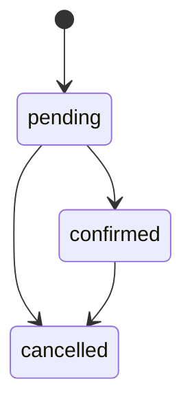
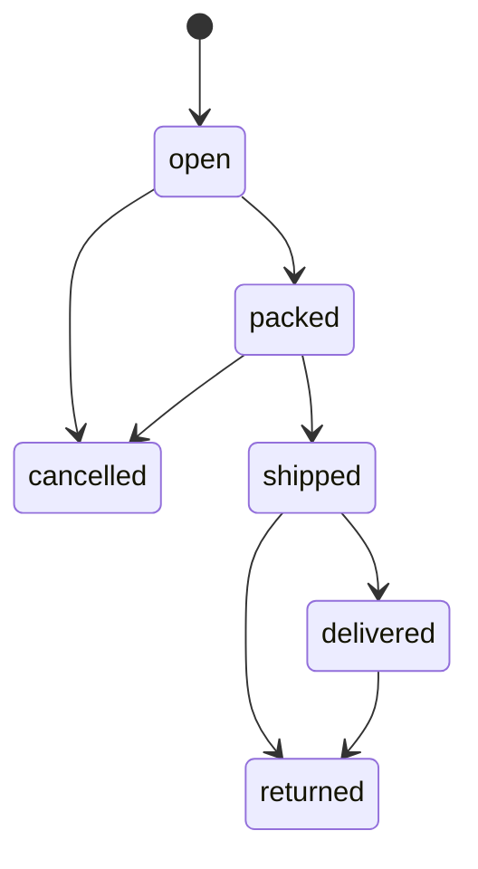

> ESD design er ongsho · [Suchipotro ar version](README.md) · Shob kaj e age: Section 1.4 ([01-overview.md](01-overview.md))

## 8. Core flow ar business rule

Ei section er Go code (`pricing`, `phone`, `order` state machine) `go vet` ar `go test -race` pass kore (v1.5 Go 1.27.3 e chalano, CI te `GOTOOLCHAIN=go1.27.3`; mutation test e `order` er 40 ta mutant shob dhora pore, `pricing` er 179 tar moddhe baki 4 ta equivalent). v1.7: Go 1.27.3 e abar chalano (`-race` shoho, coverage 100%); `pricing` er notun `ErrCouponNotApplicable` branch e 6 ta hate kora mutant shob dhora pore, puro mutation test v1.7 e abar chalano hoyni. Code file e: [`backend/internal/phone`](../../backend/internal/phone/phone.go), [`pricing`](../../backend/internal/pricing/pricing.go), [`order`](../../backend/internal/order/order.go) (test shoho). v1.6: doc e code er copy nai; niyom ei section er lekha te, asol code file e. Niyom bodlate age ei lekha, tarpor code ar test.

### 8.1 Phone number

Je format ei ashuk (dash, space, `880`, `00880`, Bangla shonkhya), save er age `+8801XXXXXXXXX` e anbe. Tritiyo digit 3 theke 9 (Bangladesh er mobile operator). Digit ar separator (space, `.`, `(`, `)`, `-` ar `–` er moto dash) chhara onno okkhor thakle bhul, chupchap fele dey na. v1.3: phone theke copy kora lukano chinho (LRM, zero-width space, U+202A/U+202C) bad jay; `+` shudhu shuru te, ar tarpor `880` thakte hobe (`+1 712 345 678` ager version e BD number hoye jeto).

Code: [`backend/internal/phone/phone.go`](../../backend/internal/phone/phone.go), test [`phone_test.go`](../../backend/internal/phone/phone_test.go).

### 8.2 Customer login (OTP)

**OTP pathano** (`POST /api/auth/otp/send`):

1. Phone normalize. Turnstile, rate limit (phone e 15 minute e 3, dine 10), shop er daily SMS cap, ar oi phone 24 ghontar lock e kina check (Section 7.8).
2. `crypto/rand` diye 6 digit code (`rand.Int(rand.Reader, big.NewInt(1000000))`, samne zero shoho 6 digit).
3. `otp_codes` e `code_hash = HMAC-SHA256(OTP_SECRET, phone + ":" + purpose + ":" + code)`, `expires_at = now + 5 minute`.
4. `sms.send` job queue te. Shudhu `APP_ENV=local` e SMS na pathiye code log e likho (staging e shudhu team er number, 13.1); production e log mode chalu thakle server start-i hobe na. v1.7: job er payload e code ekhon plain text (6.1 er "secret plain text e na" bhange, backup e prai ek bochor thake); kivabe thik hobe 16.1 (M4 er age).

**OTP verify** (`POST /api/auth/otp/verify`), attempt gona chhara baki ta ek transaction e:

1. Oi phone ar purpose er shesh, use na hoya, expire na hoya OTP nao. Na pele `400 otp_invalid`.
2. Attempt age gono: ei `UPDATE` verify er transaction er age, nijer commit e (autocommit), jate porer step e `ROLLBACK` holeo gona thake, ar parallel request e-o 5 er beshi na hoy. Kichu na ele `400 otp_too_many_attempts` (ba expire hole `otp_invalid`):
   ```sql
   UPDATE otp_codes SET attempts = attempts + 1
   WHERE id = $1 AND attempts < 5 AND consumed_at IS NULL AND expires_at > now()
   RETURNING code_hash;
   ```
3. Hash tulona `hmac.Equal` diye (constant time). Mille consume, v1.7: conditional, `UPDATE otp_codes SET consumed_at = now() WHERE id = $1 AND consumed_at IS NULL RETURNING id`; kichu na ele already use hoyeche, `400 otp_invalid` (ekoi code e duita parallel verify duita session pay na, 8.3 er TOTP er moto). Purpose `checkout` e consume order er transaction e (8.6 step 9). Na mille, oi phone er 24 ghontar bhul 10 chhuyle 24 ghonta lock ar alert (7.8).
4. `users` e `(shop_id, phone)` diye upsert. Delete kora account er phone `NULL`, tai shei manush notun account pay, purono data ashe na.
5. Oi phone er guest order account e jog: `UPDATE orders SET user_id = $1 WHERE shop_id = $2 AND customer_phone = $3 AND user_id IS NULL`. Eta **shudhu OTP verify er por**, kokhono age na.
6. `X-Cart-Key` thakle guest cart merge (8.4).
7. Session: `token = rand.Text()`, database e `sha256(token)`, `subject_type = 'customer'`, `user_id`, `expires_at = now + 30 din`. `last_used_at` ghontay ekbar-er beshi update na.

Website e cookie: `__Host-sid=<token>; HttpOnly; Secure; SameSite=Lax; Path=/; Max-Age=2592000`. Token kokhono JavaScript e (localStorage) rakhbe na.

### 8.3 Staff login

1. Email + password. Password hash: `crypto/pbkdf2`, SHA-256, 600,000 iteration, 16 byte random salt. Format `pbkdf2-sha256$600000$<base64 salt>$<base64 hash>`. Tulona `subtle.ConstantTimeCompare`. Ochena email e-o ekta dummy hash er sathe tulona (timing dekhe email chena na jay), ar ek shathe 4 tar beshi PBKDF2 na (semaphore, CPU DoS). `locked_until` er age hole `429`. Bhul hole `failed_logins + 1`; 5 er por protiti bhul e `locked_until = now + 1 minute` (soft lock), 10 ar 50 e owner alert; thik hole 0. IP onujayi limit 7.8.
2. Password thik ar TOTP set thakle `sessions` e `stage = 'mfa_pending'` row (temp_token, 5 minute). TOTP (6 digit, 30 second, RFC 6238, `crypto/hmac` + SHA-1, ±1 step) chaibe; ek temp_token e 5 bar (`mfa_attempts`). Temp_token jure gona `staff.failed_mfa`: TOTP ba recovery code e 10 bar bhul hole 30 minute `locked_until` ar owner alert, thik hole 0. Na hole password jana keu protibar notun login e notun temp_token niye ghontay prai 10% chance e code milay. Time-step `staff.totp_last_step` er beshi hote hobe, tai ekoi code duibar cholbe na; v1.5: eta ekta conditional `UPDATE staff SET totp_last_step = $2 WHERE id = $1 AND (totp_last_step IS NULL OR totp_last_step < $2) RETURNING id`, kichu na ele code already use hoyeche (duita parallel login ekoi code e duita session pay na). Owner, admin ar staff, shobar jonno TOTP badhyotamulok (staff o customer er phone ar thikana dekhe); Phase 3 e vendor role o.
3. TOTP thik hole oi row `stage = 'active'`, `expires_at = now + 12 ghonta`, cookie `__Host-asid` (7.1). Phone harale 10 tar ekta recovery code (`staff_recovery_codes`, protiti ekbar).
4. Prothom login (`must_change_password` ba TOTP nai): password (ar TOTP thakle TOTP) er por `stage = 'setup_pending'` session (15 minute, cookie `__Host-asid`). Ei session shudhu `/auth/password`, `/auth/totp/setup`, `/auth/totp/enable` ar `/auth/logout` e chole, baki shob admin API `403 setup_required`. Age password bodlano, tarpor TOTP setup; enable hole session `active` (12 ghonta) ar 10 ta recovery code dekhay. Password bodlale, deactivate ba role bodlale shob session revoke. Shob login (thik/bhul) audit log e.
5. v1.5: TOTP secret `crypto/aes` GCM e `TOTP_KEY` (13.5) diye encrypt, AAD = `shop_id:staff_id:key_version`, tai ek staff er ciphertext onno staff er row e copy korle decrypt hoy na; key er version `staff.totp_key_version` e (rotation e notun version, purono row pore re-encrypt). Recovery code er hash `HMAC-SHA256(RECOVERY_SECRET, staff_id:code)`; `RECOVERY_SECRET` rotate korle shob staff ke notun code dite hobe.

### 8.4 Cart

| Niyom | Bistarito |
|---|---|
| Dam | Cart e dam save hoy na. Protibar `GET /api/cart` e variant er bortoman dam |
| Quantity | Kom-poksha 1, beshi hole stock ar 50 er moddhe je ta kom |
| Bondho product | `is_active = false` hole cart theke bad, response e notice |
| Guest cart | Website cookie `__Host-cart=<random>`, API te `X-Cart-Key`. Database e `sha256` |
| Merge | Login e guest cart er item account cart e jog. Ek-i variant hole quantity jog, stock e cap. Tarpor guest cart muche fela |
| Purono cart | 30 din kono bodol na hole guest cart muche fela (daily job) |
| Vendor | Marketplace e cart vendor onujayi group kore dekhay (alada parcel; `per_vendor` hole alada delivery charge). Single store e group nai |

### 8.5 Dam er hishab (`pricing` package)

Shob hishab ekta pure package e. Checkout, quote, order edit, packing, shob jaygay **ei function gulo-i** use hobe, onno kothao alada hishab likhbe na.

| Function | Kokhon | Ki dey |
|---|---|---|
| `Calculate` | Quote, checkout | Order er taka, protiti line er `discount_share`, protiti vendor er taka (fulfillment). Bhul input e `ErrInvalidInput` (v1.3; v1.5: fixed line e `WeightG` 0). v1.7: coupon na khatle (eligible subtotal 0 ba `min_order` er kom) `ErrCouponNotApplicable` |
| `Reprice` | Packing e asol ojon (`Edit = false`), order edit (`Edit = true`) | Notun hishab, prepaid hole refund er poriman. Line er shonkhya na mille `ErrLineCount`; snapshot theke dam ba vendor bodlale, qty barale ba edit e ojon barale `ErrInvalidInput`. v1.4: je vendor er line bodlay nai tar taka hubohu ager; coupon ashe order er snapshot theke, ager discount thakle coupon nil e `ErrInvalidInput`. v1.5: fixed line e `WeightG` 0, ar Original er line, fulfillment ar order er taka nijeder moddhe na mille (COD te line total = `LineTotal`, Qty 0 er line e 0) `ErrInvalidInput` |
| `Commission` | Checkout (marketplace) | Line er commission. Single store e `commission_bps = 0`, tai 0 |
| `Allocate` | Uporer gulor bhetore | Ekta taka ke onupat onujayi bhag; bhag gulor jog thik mot er shoman |
| `LineFromItem`, `EditWeightG` (v1.5) | Packing, edit | `order_items` er row theke `Line` ar ager `LineResult` (removed hole Qty 0, ojon-variable e packed ba ordered ojon, fixed e 0); edit e qty komale notun ojon onupate |

Bhag er niyom: discount eligible line gulor moddhe line total onujayi; delivery charge (`per_order` mode e) vendor gulor moddhe subtotal onujayi. Bhag "largest remainder" niyome, tai jog shob shomoy mot er shoman, ek poisha o hariye jay na. Single store e vendor ekta, tai fulfillment er taka = order er taka, ar result v1.0 er hubohu.

Ojon-variable line e `WeightG` holo **puro line er mot ojon** (order e `nominal_weight_g × qty`, packing e asol mot ojon). `Qty` diye abar gun hoy na. `nominal_weight_g` NULL hole `WeightG` 0 hoy, ar `Calculate` error dey (v1.2 e line ta free hoye jeto).

Order edit e (`Edit = true`) fixed coupon er discount eligible subtotal er onupate kome: ৳900 + ৳100 er order e ৳100 coupon thakle ৳900 er item bad dile ৳100 er item ৳10 discount pay, free hoy na. Min_order er "cliff" nai, tai prepaid e kichu bad dileo total bare na. Packing e (`Edit = false`) ager niyom: ojon komle fixed discount puro thake. Edit e quantity ba ojon barano jay na (notun order), `Reprice` nijei atkay.

v1.4: **Onno vendor er taka freeze.** Ager version e `Reprice` puro order er discount abar shob line e bhag korto, tai marketplace e ek vendor er packing onno vendor er fulfillment er total bodlato (B ship hoye gele `cod_amount` ar total mile na, pore ledger o). Ekhon je vendor er kono line bodlay nai (`Qty`, `WeightG` ager moto), tar line total, `discount_share` ar delivery hubohu ager. Bodla vendor gulo uporer niyom e chole, kintu shudhu nijeder bhag e: fixed coupon e tader nijeder ager discount (packing e eligible er beshi na, edit e onupate); percent coupon e order er percent discount (cap shoho) jotota bodlay, tara thik totota pay (delta). Absolute hishab (notun percent theke frozen bhag bad) korle rounding e frozen bhag ek poisha beshi thakte pare, ar ditiyo dhape prepaid customer ek poisha beshi dito; delta niyome eta hoy na. Single store e vendor ekta, tai result v1.3 er hubohu (200,000 random case e milano; duita ichchhakrito bytikrom niche, v1.5). Delivery 0 hoy shudhu jodi oi vendor er shob line bad (`Qty` 0); ৳0 er line (free gift) baki thakle delivery thake.

v1.4: **Coupon er shorto snapshot.** `Reprice` er `Coupon` ashe `orders.coupon_*` theke (checkout e copy, 8.6 step 15), `coupons` table theke na: admin pore coupon edit ba bondho korleo purono order er packing/edit er hishab bodlay na. Ager discount ache kintu `Coupon` nil hole `ErrInvalidInput` (ager version e prepaid order e kichu na bodlei total ৳900 → ৳1,000 hoye jeto). Marketplace commission o `order_items.commission_bps` (order er shomoyer rate) diye, `vendors.commission_bps` diye na.

v1.5: **`order_items` theke line.** Packing ar edit er `Original` ar notun line shudhu `LineFromItem` diye. `status = 'removed'` er item DB te ager `quantity` niye thake (CHECK `> 0`), kintu hishab e `Qty` 0 ar `WeightG` 0. Ojon-variable e `WeightG` = `packed_weight_g`, na thakle `ordered_weight_g`; fixed line e `WeightG` 0 (`order_items_weight_check` e fixed item e ojon-i thake na). Item ojon-variable kina ashe `order_items.variable_weight` (snapshot) theke, `products` theke na. Edit e ojon-variable line er qty komale notun `ordered_weight_g = EditWeightG(ordered_weight_g, purono qty, notun qty)` (onupate, niche round, kom-poksha 1 gram). Ager version e removed item ke `quantity` diye pathale COD te oi vendor er porer packing e item ta abar bill e jog hoto, kono error chhara; ekhon `Reprice` er Original check eta atkay, ar DB te removed item er taka 0 (`order_items_removed_zero_check`).

v1.5: **Fixed line e `WeightG` 0.** Fixed line er dame ojon lage na, kintu `Reprice` vendor bodleche kina `WeightG` diyeo dekhe: kono caller fixed line e ojon dile vendor bhul kore bodla dhora porto ar freeze bhangto. Ekhon `Calculate` ar `Reprice` duitai fixed line e `WeightG != 0` hole `ErrInvalidInput`.

v1.5: **Original er check.** `Original` database theke ashe, jekhane cross-row CHECK nai. `Reprice` age dekhe: protiti line er discount er bhag 0 theke line total porjonto, Qty 0 er line e taka 0, COD te line total = `LineTotal(line)` (prepaid e tar beshi na, cap), protiti vendor er ekta-i fulfillment ar tar subtotal/discount line er jog, ar order er taka fulfillment er jog. Na mille `ErrInvalidInput` (ROLLBACK ar log), chupchap hishab na.

Jana shima (v1.4 freeze er fol): bodla vendor er discount tar notun eligible er beshi hoy na, ar frozen vendor er bhag bodlay na. Tai A ৳5,000 ar B ৳5,000, 10% coupon (cap ৳100) e bhag ৳50 + ৳50; edit e A er ৳10 baki rakhle A er discount ৳10, mot ৳60, jodio baki item e notun hishab ৳100 dito. Prepaid e total kokhono bare na, kintu eta customer er khoti; Phase 3 er age thik koro (16.1). Checkout e discount 0 hole (rounding) `Reprice` e-o 0 thake, ojon barleo.

Single store e v1.5 er result v1.3 er hubohu, duita ichchhakrito bytikrom chhara: ৳0 er line baki thaka vendor er delivery thake (v1.3 e 0), ar ager discount thakle coupon snapshot chhara error (v1.3 e chupchap discount 0). 400,000 random case (qty ardhek komano shoho) e milano.

Code: [`backend/internal/pricing/pricing.go`](../../backend/internal/pricing/pricing.go).

Unit test: v1.0 er shob case ager result-i dey; tar shathe marketplace, `Reprice` (packing ar edit), commission, ar 20,000 random input e (prepaid/COD × packing/edit) niyom gulo kokhono bhange na (bhag er jog, prepaid e customer beshi dey na). v1.4: dui dhap `Reprice`, kichu na bodlale hubohu ager result, je vendor bodlay nai tar taka freeze, shima (free delivery `>=`, half-up rounding) ar protiti input guard er test; mutation test e (19 ta bhul) shob dhora pore. v1.7: `TestCouponNotApplicable` (`TestCalculate` er "min order not met" ar "vendor coupon min_order" case ekhane; error ar coupon chhara total duitai dekhe, shima shoho) ar `TestRepriceEditThenPackRandom` (asol kram: edit, tarpor vendor onujayi pack; protiti dhap `LineFromItem` diye row theke; 20,000 order, review e 40 seed × 50,000 o chalano, kono niyom bhange ni). Test: [`pricing_test.go`](../../backend/internal/pricing/pricing_test.go).

Aro niyom: coupon er `min_order` na mille checkout `409 coupon_invalid` dibe (chupchap 0 discount na). v1.7: eta ashe `Calculate` er `ErrCouponNotApplicable` theke, caller nije eligible subtotal hishab kore na (Rule 1); coupon er eligible line er subtotal 0 hole-o (vendor coupon er vendor er line cart e nai, ba shudhu ৳0 er line) ekoi error. Ager version e emon order discount 0 diye hoto, kintu 8.6 step 11 er `used_count + 1` ar redemption customer er `per_phone_limit` khete. Quote e coupon chhara abar `Calculate` kore total dekhao, shathe `coupon_invalid`. Delivery zone er `min_order` (discount er porer taka) na mille `409 below_min_order`. Free delivery: discount er porer taka `free_delivery_over` er shoman ba beshi hole (`>=`). Vendor coupon (`coupons.vendor_id`) er `min_order` shudhu oi vendor er line er upor. `per_vendor` mode e free delivery shima puro order er upor dekha hoy; shima chhuyle shob parcel free. Jana shima (Phase 3 er age thik koro): `per_order` mode e ek vendor er shob line bad hole tar delivery er bhag 0 hoy, baki vendor der moddhe abar bhag hoy na, tai order er delivery charge kome.

### 8.6 Checkout: `POST /api/orders`

Ei order e kaj korbe. Ekta step fail korle porer step e jabe na.

**Transaction er age:**

1. `Idempotency-Key` header check (max 64 okkhor). Na thakle `400`. `idempotency_hash` = shudhu request body er canonical JSON er `sha256`: customer, recipient, address, note, `coupon_code`, `payment_method`, `expected_total`, `consent`. `turnstile_token`, `otp_code` ar `website` hash e na, karon retry te egulo bodlay; thakle response harano retry `422` pay ar customer notun key e duplicate order kore. v1.4: server er cart-o hash e na: order hole step 17 e cart khali hoy, tai response harano retry te cart er list alada hoye `422` ashto (v1.3 er bug). Cart er dam-shoho mot `expected_total` e dhora thake, tai `expected_total` badhyotamulok, na thakle `400 validation_failed`.
2. Ei key diye age order hoye thakle: hash mile → sheta-i ferot dao (`200`), notun kichu na; hash na mille `422 idempotency_key_reused`. Eta Turnstile er **age**, karon retry te Turnstile token already use hoye geche.
3. Honeypot field (`website`) khali na thakle `400`. `otp_code` na thakle Turnstile token Cloudflare er siteverify te check (token ekbar-i cholbe). `otp_code` thakle Turnstile lage na (prothom request e check hoyeche, ar OTP pathano hoy shudhu Turnstile pass korle), kintu tokhon `otp_code` **shob shomoy** verify hoy (step 8), OTP lagbe kina tar upor nirbhor na; bhul hole `400 otp_invalid`. Na hole bot je kono `otp_code` diye Turnstile edate parto.
4. `consent` na thakle `400`. Customer ar recipient er phone normalize, naam/thikana validate.
5. Delivery zone khojo: age `(district, area)` mile emon, na pele `(district, area IS NULL)`. Na pele `409 area_not_served`.
6. Customer **ba** recipient er phone `blocked_phones` e thakle ar payment COD hole `403 phone_blocked` (online payment allowed).
7. Cart load. Khali hole `400 cart_empty`. Product ba variant bondho hole `409 out_of_stock`, item er vendor `active` na hole `409 vendor_unavailable` (marketplace).
8. Risk flag hishab (8.7, client IP 3.2). v1.7: flag er "total" holo `expected_total` (step 1 e badhyotamulok): asol hishab step 12 e, ar shekhane na mille `409 price_changed`, tai ekhane alada `Calculate` lage na, ar client er total diye shudhu flag hoy, dam na (Rule 1). OTP lagle ar `otp_code` na thakle: checkout OTP pathao, `409 otp_required`. `otp_code` thakle (OTP lagbe kina dekhar age-i) verify (8.2 er moto, purpose `checkout`): attempt gona ar hash tulona; thik hole `otp_verified = true`. v1.7: ekhane consume **na**, OTP er `id` rakho (step 9 e consume).

**Transaction (`BEGIN ... COMMIT`, `READ COMMITTED`):**

9. `pg_advisory_xact_lock` (shop + key) niye abar key check (6.4). Pele `ROLLBACK`, step 2 er moto uttor. Ekoi key er duita request ek shathe ashleo ekta-i order, ar duplicate ta bhul `409` pay na. v1.7: tarpor `otp_code` thakle OTP consume: `UPDATE otp_codes SET consumed_at = now() WHERE id = $1 AND consumed_at IS NULL RETURNING id`; kichu na ele `ROLLBACK`, `400 otp_invalid` (onno key er order e code ta already use hoyeche). Porer kono step fail korle (`price_changed`, `out_of_stock`, `coupon_limit_reached`) ROLLBACK e OTP abar use kora jay, tai customer notun OTP ar notun Turnstile chhara-i abar submit kore; ager version e step 8 e consume hoto, ar `price_changed` er por OTP box atke jeto. OTP row onno kono flow er lock er sathe joray na, tai lock er kram e prova nai.
10. Item gulo `variant_id` onujayi **sajiye** (deadlock thekate) protitir jonno atomic stock komano (6.4, product o active). Kono ekta 0 row hole `ROLLBACK`, `409 out_of_stock` (kon variant sheta `details` e). Test e sort chhara ulto kram er 20 ta checkout e 15 ta deadlock hoyeche, sort kore 0. Ek transaction e ekadhik variant chhoy emon shob code (cancel e restock, edit, return, adjust) ekoi kram e sajabe.
11. Coupon thakle: **age** atomic `used_count + 1` (6.4, coupon row lock hoy), **tarpor** phone er redemption count `per_phone_limit` er kom kina. Kono ta na mille `ROLLBACK`, `409 coupon_invalid` ba `coupon_limit_reached`.
12. `pricing.Calculate` diye total, line er `discount_share` ar vendor onujayi taka (`marketplace.delivery_charge_mode`, default `per_order`). Marketplace e line er `commission` (`pricing.Commission`, vendor er `commission_bps`). Zone `min_order` check. `expected_total` (badhyotamulok, step 1) na mille: `ROLLBACK`, `409 price_changed`. `Calculate` `ErrCouponNotApplicable` dile (v1.7) `ROLLBACK`, `409 coupon_invalid` (step 11 er `used_count` o ferot); onno error dile (input bhul, mane code er bug) `ROLLBACK`, `500`, log.
13. Order number (`shop_counters`; `shops.order_prefix` + `-` + `100000 + value`), transaction er shesher dike, karon counter row er lock commit porjonto thake. `public_token = rand.Text()`, `delivery_deadline = now + (same_city ? 5 : 10) din`.
14. Status: COD te confirmation lagle `pending`, na lagle shorasori `confirmed`. Online payment e `pending` ar `payment_status = 'pending'`. `display_status = order.Summary(status, nil)`: fulfillment ekhono insert hoyni, ar khali `fs` e `Summary` `confirmed` dey (order test er "checkout step 14" case).
15. `orders` insert (`ON CONFLICT (shop_id, idempotency_key) DO NOTHING`). Kichu ferot na ele `ROLLBACK` kore ager order ferot dao. v1.4: coupon thakle shathe tar shorto (`coupon_code`, `coupon_kind`, `coupon_value`, `coupon_max_discount`, `coupon_vendor_id`, `coupon_funded_by`, step 11 er `RETURNING` theke); COD confirmation lagle `confirm_token_hash` (8.10).
16. Protiti vendor er jonno ekta `order_fulfillments` row (`seq` 1, 2, ...; `status = 'open'`; `Calculate` er oi vendor er taka). Single store e ekta-i. Tarpor `order_items` (vendor, fulfillment, naam, variant label, sku, dam, kena dam er snapshot, `discount_share`, `commission`, vendor er `commission_bps`; v1.5: `variable_weight` snapshot, ojon-variable hole `ordered_weight_g` = `nominal_weight_g × qty`, fixed hole ojon NULL), `inventory_movements` (`reason = 'order'`, `change = -qty`), `order_status_history`, `coupon_redemptions`.
17. Cart khali.
18. Job: `sms.order_placed` (confirmation lagle confirm link shoho; link 8.10 er `confirm_token`, job payload e shudhu `order_id`), `alert.new_order`. COD pending hole `order.auto_cancel_unconfirmed` (setting er ghonta por, default 24). Online hole `order.auto_cancel_unpaid` (30 minute por; cancel er age reconcile, 8.9).

Deadlock (`40P01`) ba serialization (`40001`) error hole puro transaction ekbar abar chalao.

**Transaction er por:**

19. Online payment hole payment row banao ar SSLCommerz session (8.9). Fail hole order thakbe, `payment_url: null` ar customer `/pay` diye abar cheshta korte parbe.

### 8.7 Risk ar OTP

Settings e `checkout.otp_mode`: `never`, `risky`, `all_cod`, `all`.

| Flag | Kokhon |
|---|---|
| `cod_high_amount` | COD ar total `checkout.risk.cod_amount_over` er beshi (default ৳3,000 = `300000`) |
| `phone_refused_before` | Ei phone er age kono fulfillment `returned` (customer nite chayni) |
| `many_orders` | Ek phone ba ek client IP (3.2) theke ek ghontay 3 ba beshi order |
| `new_phone_high_amount` | Ei phone er prothom order ar total `checkout.risk.new_phone_amount_over` er beshi |

v1.7: flag er "total" holo checkout er `expected_total` (8.6 step 8); step 12 e mile na hole order-i hoy na.

| `otp_mode` | OTP lagbe |
|---|---|
| `never` | Kokhono na |
| `risky` | Kono flag thakle (online payment e na) |
| `all_cod` | Shob COD order e |
| `all` | Shob order e |

Flag gulo `orders.risk_flags` e save hoy, admin order er pashe dekhte pay. COD confirmation er setting alada: `checkout.cod_confirmation` = `none`, `risky`, `all`.

### 8.8 Order ar fulfillment er status (state machine)

Duita state machine (3.7). Order er ta customer ar payment er, fulfillment er ta ek vendor er pack-ship er.

Order:



Fulfillment (order `confirmed` hoyar por-i `packed` e jete pare):



Code: [`backend/internal/order/order.go`](../../backend/internal/order/order.go), test [`order_test.go`](../../backend/internal/order/order_test.go) (golden table shoho).

Customer ar admin ekta status dekhe: `orders.display_status = order.Summary(order.status, fulfillment status gulo)`. Single store e eta v1.0 er status er hubohu; marketplace e vendor gulo alada stage e thakle `partial`.

Status bodlano **shudhu duita function** diye: `TransitionOrder(ctx, tx, orderID, to, actor, note)` ar `TransitionFulfillment(ctx, tx, fulfillmentID, to, actor, note)`. Duitai age order row, tarpor fulfillment row `SELECT ... FOR UPDATE` kore, `CanTransitionOrder` (order er `Payment{Method, Paid}` shoho) ba `CanTransitionFulfillment` check kore (na hole `409 invalid_transition`; online order unpaid hole `409 payment_required`), side effect kore, `order_status_history` e likhe (`fulfillment_id` shoho), ar `display_status` abar hishab kore. Fulfillment `packed` korte order `confirmed` thakte hobe. Vendor actor shudhu nijer `vendor_id` er fulfillment chhute pare. **Upore cascade**: `TransitionFulfillment` e shob fulfillment cancelled hole (`AllCancelled`) ek-i transaction e `TransitionOrder(confirmed → cancelled, System)`, tarpor `Summary`. **Niche cascade** (v1.3): `TransitionOrder(→ cancelled)` `order.CancelCascade(fs)` er open/packed fulfillment gulo ek-i transaction e cancel kore, fulfillment cancel er side effect shoho, history te order er actor diye. Actor er onumoti `CanTransitionOrder` age-i dekheche (customer: shob open/cancelled; staff: packed o; system: pending order, ba `AllCancelled`). Ei cascade `TransitionFulfillment` dake na, tai upore abar `TransitionOrder` ashe na. Onno kothao `UPDATE ... SET status` likhbe na. Lock er kram shob code e ek: order → payment → fulfillment → variant (sajano) → coupon → counter.

Single store e "Packed", "Shipped" button order page ei thake; backend oi order er ekmatro fulfillment e `TransitionFulfillment` dake.

| Bodol | Side effect |
|---|---|
| Order `pending → confirmed` | `confirmed_at`. COD: confirm link (customer, 8.10 er `confirm_token`) ba phone call (staff). Online: shudhu `payment_status = 'paid'` er por, validation (system) ba staff (gateway e nije dekhe). DB CHECK o atkay |
| Order `→ cancelled` | `CancelCascade` er open/packed fulfillment gulo `cancelled` (niche er side effect shoho; refund oikhane-i, order level e alada refund row **na**), coupon redemption muche `used_count = GREATEST(used_count - 1, 0)` (v1.7: admin `used_count` komale `CHECK` e puro cancel atke jeto), SMS |
| Fulfillment `open → packed` | Shob item pack, ojon-variable item er asol ojon ar `pricing.Reprice`, FIFO batch allocation (8.11), `packed_at` |
| Fulfillment `packed → shipped` | Shipment row lagbe (COD hole `cod_amount` = fulfillment er `total`). `shipped_at`, tracking shoho SMS |
| Fulfillment `shipped → delivered` | `delivered_at`, review link SMS. COD order er shob active fulfillment delivered hole `payment_status = 'paid'` (courier er taka pore COD settlement e mile) |
| Fulfillment `→ cancelled` | Oi fulfillment er stock ferot (`inventory_movements` `cancel`), pack hoye thakle batch ferot (`order_item_batches` theke), prepaid hole oi fulfillment er **bortoman** `total` refund (`refunds.kind = 'cancel'`, `fulfillment_id`; DB te ekbar-i, `refunds_cancel_once`); v1.5: total 0 hole refund row hoy na (edit e `Reprice` already ferot diyeche, 8.11). Refund er age order row lock, tarpor mot refund (failed bad) ≤ paid check. Shob fulfillment cancelled hole order o `cancelled` (system, `AllCancelled`). v1.7: shop er `staff` role fulfillment cancel korte pare na, order cancel er moto (11.2): `403 forbidden` |
| Fulfillment `shipped/delivered → returned` | Staff bachai: stock e ferot (non-perishable) ba `wastage`. Prepaid hole, ba COD te taka newa hoye thakle, refund. Courier parcel ferot dile age shipment `returned`; staff abar pathale notun shipment (fulfillment `shipped` e thake), na pathale fulfillment `returned`. v1.7: refund hobe emon return shudhu owner/admin; `staff` role shudhu refund chhara return (COD, taka newa hoyni) |

### 8.9 SSLCommerz payment

**Shuru:**

1. Ei order er ager `initiated` payment gulo `cancelled` (`/pay` retry). Notun `payments` row: `tran_id = rand.Text()` (random; order number shudhu shop er bhetore unique, tai multi-tenant e duita shop er number mile jete pare), `amount = order.total`, `status = 'initiated'`, `reconcile_after = now + 15 minute` (v1.4). Eta shudhu local status: oi purono `tran_id` e pore VALID IPN ele-o niche-r validation mane.
2. Session API te POST (form): `store_id`, `store_passwd` (shop_credentials theke, sandbox/live o oikhane), `total_amount` (poisha theke taka, 2 doshomik: `20400` → `"204.00"`), `currency=BDT`, `tran_id`, `success_url`, `fail_url`, `cancel_url`, `ipn_url`. SSLCommerz e mandatory: `cus_name`, `cus_email` (customer na dile shop er `branding.email`), `cus_add1`, `cus_city` (district), `cus_postcode` (na thakle district er default), `cus_country`, `cus_phone`, `shipping_method`, ar product er naam, category, profile.
3. Response er `GatewayPageURL` e customer ke redirect.

**Validation** (IPN `POST /api/payments/sslcommerz/ipn` ar success return, duitai ekoi function, idempotent; shobcheye guruttopurno):

1. Form theke `tran_id`, `val_id` nao. `tran_id` diye payment khojo; sekhan thekei shop (IPN e `X-Shop-Host` thake na) ar oi shop er credential. Na pele `404`, log. v1.7: form er `status` `VALID`/`VALIDATED` na hole ba `val_id` khali hole Validation API call na, payment row bodlay na: shudhu log (IPN e `200`, return e redirect).
2. Transaction e age oi order row, tarpor payment row `SELECT ... FOR UPDATE` (lock er kram 8.8: order → payment; ulto korle `/pay` ba auto-cancel er sathe deadlock). Already `succeeded` hole `200` (abar kichu korbe na). Local status `cancelled` ba `failed` holeo (purono tab, `/pay` retry) validation chalao: gateway VALID bolle sheta-i shotti.
3. Order Validation API call: `val_id`, `store_id`, `store_passwd`, `format=json`. Timeout ba 5xx hole payment `failed` **na**, `500` ferot (SSLCommerz IPN abar pathay, reconcile o dhore).
4. Response e `status` `VALID` ba `VALIDATED`, `tran_id` mile, `amount` payment er amount er shoman (taka string ke float chhara poisha te parse: `"204.00"` → `20400`), `currency` `BDT`, ar `currency_type` `BDT` o `currency_amount` o shoman (BDT store e ek-i thake). v1.7: shudhu `VALID`/`VALIDATED` ar `tran_id` mile kintu amount ba currency mile na hole payment `failed`, `reconcile_after = NULL` (v1.5: mismatch barbar reconcile hoye alert na dey), alert, order confirm na. Response `VALID` na hole (`INVALID_TRANSACTION`, `FAILED` ...) ba response er `tran_id` form er sathe na mille payment row bodlay na: shudhu log (`tran_id` mismatch e alert), `reconcile_after` jemon chhilo. Karon return URL unauthenticated (CrossOriginProtection bypass, 4.2): ager niyome `tran_id` jana je keu bhul `val_id` ba nijer onno payment er `val_id` diye payment `failed` ar reconcile bondho korte parto, ar failed attempt er por ekoi session e pay korle IPN harale auto-cancel er ekbarer reconcile er por keu dhorto na (v1.4 er late payment er bug ferot ashto).
5. Transaction e: payment `succeeded`, `val_id`, `bank_tran_id`, `risk_level`, `store_amount` (fee kete, settlement mela), `raw`, `reconcile_after = NULL`; order `payment_status = 'paid'` (age), tarpor `TransitionOrder(pending → confirmed, system)`; `sms.paid` job. `risk_level = 1` hole payment succeeded, kintu order confirm na kore staff review alert.
6. Order already `cancelled` (30 minute por auto-cancel ba customer) hoye thakle: payment succeeded rakho, order cancel e thakbe, refund row (`pending`, `kind = 'late_payment'`) ar admin alert.
7. Order already paid (duita tab ba `/pay` retry te duita payment): ei payment succeeded, auto refund row (`pending`, `kind = 'duplicate'`), admin alert. Kokhono error ferot dibe na, na hole SSLCommerz IPN barbar pathabe.

**Return URL**: `success` e upore validation function chaliye `303` diye website er `/order/{token}/done` e; `fail`/`cancel` shudhu redirect. Browser er pathano status kokhono paid kore na. Done page API theke status dekhay (validation dheri hole kichukkhon "payment check hocche").

**Reconcile** (v1.4): `payment.reconcile` job protiti 10 minute e `reconcile_after <= now()` emon payment nay. Eta shudhu `initiated` na: `/pay` retry te local `cancelled` hoya purono tab er payment o, karon gateway te oi session tokhono jibonto. Ager version shudhu `initiated` dekhto, tai customer purono tab e pay korle ar IPN harale taka katto, kintu order auto-cancel hoto ar refund row-o hoto na. Protitir jonno Transaction Query API (`tran_id`); success pele upore validation (order cancel hoye thakle step 6 er `late_payment` refund). Na hole `reconcile_after` porer dhape: toiri howar 15 minute, 1 ghonta, 6 ghonta ar 24 ghonta por; tarpor `NULL`. `order.auto_cancel_unpaid` cancel er age oi order er `succeeded` na shob payment ekbar reconcile kore. IPN path e Cloudflare WAF custom rule er skip dao. **Bot Fight Mode (free plan) skip kora jay na**: WAF custom rule ba Page Rule kono tai kaj kore na, eta puro domain e chole, ar API ba app traffic-o challenge korte pare. Tai free plan e Bot Fight Mode off rakho (Turnstile ar rate limit ache), ba Pro plan e Super Bot Fight Mode chalao ar IPN path skip koro, ba SSLCommerz er IPN IP er jonno IP Access allow rule dao (age match korle Bot Fight Mode chole na).

**Escrow**: Bangladesh Bank er 2021 er niyom e gateway delivery confirm er por merchant ke taka dite pare (12.1). Ei shop er settlement kivabe hobe SSLCommerz er sathe confirm koro; delivery confirmation pathate hole `delivered` er por job (Phase 2 API).

Refund MVP te SSLCommerz merchant panel theke kore admin e record (`refunds`, `provider_ref`), Phase 2 te refund API (`bank_tran_id` lage).

Marketplace e payment shop er (platform er) SSLCommerz account e ashe; vendor ra taka pay payout e (8.18). Multi-tenant e protiti shop er nijer SSLCommerz account (`shop_credentials`).

### 8.10 COD confirmation

1. v1.4: confirm er jonno alada token. `public_token` order-dewa browser pay (`201` response, `/order/{token}/done`), tai tar diye confirm hole onner number diye fake order dewa manush nijei confirm korte parto, SMS er phone chhara-i. Ekhon `confirm_token = base32(HMAC-SHA256(CONFIRM_SECRET, "cod-confirm:" + public_token))` er prothom 26 okkhor (130 bit). Checkout (8.6 step 15) e shudhu `orders.confirm_token_hash = sha256(confirm_token)` boshe. Token kono API response e jay na, database e o plain text e na: `sms.order_placed` job er payload e shudhu `order_id`, worker `public_token` theke token abar banay, tai retry te ekoi link.
2. SMS e link: `https://<domain>/confirm/<confirm_token>`. Page `GET /api/confirm/{confirm_token}` theke order er shar-songkhep (phone/thikana mask) ar "Order confirm korun" button. Button `POST /api/confirm/{confirm_token}` → `TransitionOrder(pending → confirmed, customer)`. Token hash er age uppercase (link e case bodlaleo chole); na mille `404`. Online order e token toiri-i hoy na (DB CHECK `orders_confirm_token_cod_check`).
3. Staff phone kore-o confirm korte pare (`TransitionOrder(..., staff, "phone e confirm")`).
4. Setting er ghonta por-o `pending` thakle `order.auto_cancel_unconfirmed` job cancel kore.
5. `/order/{token}` ar done page e confirm button nai, shudhu "SMS er link e confirm korun". v1.7 (ager lekha bhul chhilo): verify hoy `sha256(token)` diye lookup kore, secret lage na, tai `CONFIRM_SECRET` rotate korleo ager pathano link kaj kore. Je ta bhange: rotate er por pending order er SMS retry ba resend, karon worker notun secret e notun token banay ja `confirm_token_hash` er sathe mile na (`404`). Tai rotate er shomoy ek transaction e pending COD order gulor `confirm_token_hash` notun secret diye abar likho (`public_token` theke). Kono link bondho korte chaile oi order er hash bodlao, ba `NULL` kore staff phone e confirm (step 3).

### 8.11 Packing, batch ar ojon

Packing hoy **fulfillment** dhore. Single store e order ar fulfillment ek, tai staff er kache kono parthokko nai.

1. **Pick list**: ek diner (shop er timezone e) shob `open` fulfillment (order `confirmed`) er item, variant onujayi jog, area onujayi bhag. Vendor staff shudhu nijer vendor er pick list dekhe.
2. **FIFO batch** (`batch_expiry` module on thakle): protiti item er jonno expiry age shesh hobe emon batch theke `quantity_remaining` komao (6.4 er query, expire hoya batch query tei bad, `FOR UPDATE`), `order_item_batches` e likho (`variant_id` shoho). Jothesto batch na pele fulfillment pack hoy na, alert; prepaid hole customer ke 48 ghontay janao ar 72 ghontay refund (12.1).
3. **Ojon-variable item**: staff puro line er asol mot ojon (`packed_weight_g`) dey (shudhu ojon-variable item e; v1.5: fixed item e ojon dile `400 validation_failed`, DB `order_items_weight_check` o atkay). `pricing.Reprice` (8.5) diye notun line total, discount er bhag, fulfillment ar order er total. Reprice coupon er shorto abar check kore na (min_order na), delivery charge ager ta-i rakhe, percent coupon notun subtotal e, fixed coupon ager discount (notun subtotal er beshi na). Fole ojon komle customer er total kokhono bare na. v1.4: marketplace e onno vendor er fulfillment er taka bodlay na (8.5).
   - Prepaid order e customer kokhono beshi dibe na: Reprice protiti line ager line total e cap kore, ar parthokko ferot dey (`refunds`, `pending`).
   - COD order e notun total save, ar SMS e final amount.
4. **Order edit** (pack er age): item bad ba quantity kom hole stock ferot, `pricing.Reprice` (`Edit = true`) diye notun hishab, prepaid hole partial refund, history te note. Quantity barano ba notun item jog edit e na (notun order); `Reprice` eta error diye atkay. Ek vendor er shob item bad hole oi fulfillment `cancelled`, shob vendor er hole order o (8.8).
   - v1.5 er kram, ek transaction e: (a) `LineFromItem` diye Original ar notun line (bad deya item `status = 'removed'`, taka 0, quantity ager ta; ojon-variable e `EditWeightG`); (b) `Reprice`; (c) item, fulfillment ar order er notun taka save; (d) prepaid e `refund > 0` hole ekta-i refund row (`kind = 'reprice'`, `fulfillment_id` NULL); (e) je vendor er shob line bad tar fulfillment `TransitionFulfillment(→ cancelled)`: tar total ekhon 0, tai cancel er refund row hoy na; shob vendor gele order o cancel (`AllCancelled`). Fole mot refund ekbar-i, paid er beshi na. Ager version e kram bola chhilo na: cancel age hole duibar refund (B ≤ A hole guard o dhorto na), pore hole 0 taka refund e CHECK fail.
   - v1.5: je edit e kono vendor er shob item bad hoy, ba prepaid e refund toiri hoy, sheta shudhu `owner`/`admin` (11.2); `staff` role e `403 forbidden`, karon staff cancel ba refund korte pare na. v1.7: fulfillment transition eo ekoi niyom (cancel, ba refund wala return; 8.8).
5. Packing slip ar invoice website er printable page theke (A4 ar 80mm thermal er jonno alada print CSS). Marketplace e packing slip fulfillment onujayi (`SB-100245-2`).
6. **Courier parcel ferot**: shipment `returned`. Staff abar pathale notun shipment (ek fulfillment e ek shomoy ekta-i active), na hole fulfillment `returned` (8.8).

### 8.12 Inventory

| Ghotona | Ki hobe |
|---|---|
| Notun maal ashlo | `inventory_batches` (received = remaining), `variant.stock + qty`, movement `purchase` |
| Nosto/kom | Batch ar `variant.stock` theke komano, movement `wastage` ba `adjust` (note lagbe) |
| Order | `variant.stock` checkout e kome, batch kome packing e |
| Cancel/return | `variant.stock + qty`; pack hoye thakle `order_item_batches` theke batch e ferot (perishable return hole `wastage`) |
| Expire (protidin job, shop er timezone) | Expire hoya batch er `quantity_remaining` 0, variant.stock theke oi qty komano (0 er niche na), movement `expired`. Kom porle open order er jonno alert |
| Mil (protidin job) | `batch_expiry` on thakle `sum(batch remaining) = stock + open fulfillment er qty` mile kina; na mille alert |
| Protidin (job) | Low stock (`stock <= low_stock_at`) ar expiry (setting er din er moddhe, default 7) alert |
| Vendor | Stock variant e, variant ek vendor er. Vendor staff shudhu nijer variant er batch, adjust, wastage; alert oi vendor ke-o jay |

### 8.13 Coupon

| Niyom | Bistarito |
|---|---|
| Code | Save ar khoja duitai `upper()` |
| Shomoy | `starts_at`/`expires_at` (shop er timezone e admin dekhe, UTC te save) |
| Limit | Mot `usage_limit`, ar ek phone e `per_phone_limit` (guest er-o phone ache) |
| Cancel | Delivery er age cancel hole redemption muche `used_count = GREATEST(used_count - 1, 0)` (v1.7) |
| Edit | Fixed coupon er discount eligible subtotal er onupate kome (8.5) |
| Snapshot | v1.4: order e shorto copy (`orders.coupon_*`); pore coupon edit ba bondho holeo purono order er packing/edit er hishab bodlay na (8.5) |
| Hishab | Shudhu `pricing` package (8.5) |
| Vendor | `vendor_id` NULL = shob vendor er line e; thakle shudhu oi vendor er line e, `min_order` o oi line gulor upor |
| Taka ke dey | `funded_by`: `shop` (shop/platform bohon kore; vendor er commission discount er ager dam e) ba `vendor` (vendor bohon kore). Single store e parthokko nai |

### 8.14 Review

1. Review dite parbe jodi product ta oi order e thake ar tar fulfillment `delivered`.
2. Duibhabe: login kora customer nijer order theke, ba guest SMS er link theke (`order_token`). Duitai "verified purchase".
3. Ek order e ek product er ekta review (`UNIQUE (order_id, product_id)`). 30 din porjonto edit.
4. Ek-i transaction e `products.rating_sum += rating`, `review_count += 1`. Hide korle biyog, unhide korle abar jog, edit e rating er parthokko. Gor = `rating_sum / review_count`, ek doshomik e dekhano. Review e `vendor_id` (order item theke) o save hoy, pore vendor rating er jonno.
5. Account delete hole `reviewer_name = 'Deleted user'`, review thake.

### 8.15 Delivery deadline

1. Order er shomoy `delivery_deadline` (same city 5 din, onno 10 din). Perishable (fol, mach, shobji) er jonno checkout e aro kom shomoy promise ar dekhano (12.1).
2. Ghontay ekbar job: deadline er 24 ghontar moddhe kintu deliver hoyni emon fulfillment er alert (shop admin ke; marketplace e oi vendor ke-o). Dashboard e lal kore dekhano.
3. Prepaid order 36 ghontar moddhe ship na hole alert (advance payment er 48 ghontar moddhe delivery service e dewar niyom er jonno).
4. Supply na korte parle (stock, expiry): order er 48 ghontar moddhe customer ke janano, ar prepaid hole 72 ghontay refund er alert (12.1).

### 8.16 SMS

| Event | Template key | Kokhon |
|---|---|---|
| OTP | `sms.otp` | Login/checkout OTP |
| Order hoyeche | `sms.order_placed` | Order er por (confirm link shoho, dorkar hole) |
| Ship hoyeche | `sms.shipped` | Tracking shoho |
| Deliver hoyeche | `sms.delivered` | Review link shoho |
| Final dam bodlalo | `sms.amount_updated` | Ojon-variable COD order |
| Cancel | `sms.cancelled` | Karon shoho |
| Payment hoyeche | `sms.paid` | Online payment validate hole |
| Refund | `sms.refund` | Refund `done` hole, poriman shoho |

Template gulo translation key (`sms.*`), admin bodlate pare. Customer er `locale` onujayi bhasha. Mone rakho: Bangla SMS Unicode (UCS-2), ek SMS e 70 unit, multipart e protiti 67 (English e 160/153). Juktakkhor ar kar-fola alada unit, tai "okkhor" er cheye beshi gona hoy; template er length code unit e test koro. Template choto rakho, na hole ek SMS e duita-tinta SMS er khoroch hobe.

### 8.17 Background job

| Job | Kokhon chole | Ki kore |
|---|---|---|
| `sms.send` | Event e | SMS gateway e pathay, fail hole 1, 5, 15, 60 minute por abar (OTP hole shudhu 1 minute por ekbar, OTP 5 minute e expire) |
| `alert.new_order` | Order e | Admin ke email/SMS |
| `order.auto_cancel_unconfirmed` | Order + N ghonta | Ekhono `pending` COD hole cancel |
| `order.auto_cancel_unpaid` | Order + 30 minute | Age reconcile (8.9), tarpor-o unpaid online hole cancel |
| `alert.delivery_deadline` | Ghontay | 8.15 |
| `alert.inventory` | Protidin shokal 8 ta (shop er timezone) | Low stock, expiry |
| `payment.reconcile` | Protiti 10 minute | `reconcile_after` er shomoy hoya payment (local `cancelled` o) er status gateway theke (8.9, v1.4) |
| `inventory.expire`, `inventory.reconcile` | Protidin (shop er timezone) | 8.12 |
| `data.retention` | Protidin | `orders.ip`, `sessions.ip`, `audit_logs.ip` 180 din por `NULL` (`shop_app` er `audit_logs` e shudhu `ip` column e UPDATE, `001`) |
| `cart.cleanup` | Protidin | 30 diner purono guest cart |
| `session.cleanup` | Protidin | Expire hoya session ar OTP |
| `jobs.sweep` | Protiti 5 minute | Shesh attempt e crash kora job (`attempts = max_attempts`, lock 5 minute er purono) `failed_at` ar admin alert (6.4) |
| `alert.complaint_due` | Ghontay | `complaints.due_at` (72 ghonta) er 12 ghontar moddhe ba par hoye geche emon open complaint (12.1) |
| `backup.verify` | Mashe | Restore test reminder (Section 13) |

Worker niyom: 6.4 er query diye kaj nay (`failed_at IS NULL`, `attempts < max_attempts`), handler idempotent, `max_attempts` chhuyle `failed_at` ar admin alert (crash hole `jobs.sweep`), ek kaj 5 minute er beshi locked thakle abar neya jay. Recurring job scheduler `dedupe_key` (din ba ghonta shoho) diye insert kore, tai duibar hoy na. Multi-tenant e ek shop er onek job jate onno shop ke atke na rakhe, Phase 3 e shop onujayi round-robin.

### 8.18 Vendor er taka (marketplace, Phase 3)

Table gulo `010_marketplace_money.sql` e ashbe (6.6). Kintu hishab er bhitti (`line_total`, `discount_share`, `commission`, fulfillment er taka) ekhon-i `001` e save hoy, tai pore purono order er hishab o thik bhabe kora jabe.

| Ghotona | `vendor_ledger` entry (vendor er dik theke) |
|---|---|
| Fulfillment `delivered` ar return window (`checkout.return_window_days`) shesh | `sale`: + line total er jog (vendor-funded coupon hole `discount_share` bad); `commission`: − commission er jog |
| Vendor nijei deliver korle (`per_vendor`) | `delivery`: + fulfillment er `delivery_charge` |
| Window er por return ba refund | `refund`: − |
| Payout | `payout`: − pathano taka |

Payout = ledger balance, saptahe ekbar, shudhu balance 0 er beshi hole. Ledger row kokhono update ba delete na; bhul hole ulto entry (`adjustment`). Commission `pricing.Commission` (8.5) diye.

Digital Commerce guideline e marketplace ke seller er taka 10 diner moddhe dite hoy, alada chukti na thakle; return window er hold vendor chukti te likho (12.1). Commission er VAT (FY26 theke 15%) ledger e alada line, accountant er sathe thik koro.
