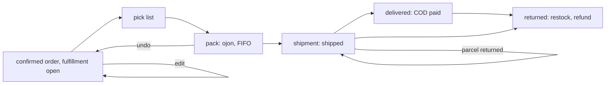

# Fulfillment: pick list, pack, undo, edit, shipment, return

Design: 8.5, 8.8, 8.11, 8.12, 11.7 item 3–7, 13 ii–iv · Milestone: M7a · Code: `backend/internal/order` (`pack.go`, `edit.go`, `shipment.go`, `transition.go`, `picklist.go`)

## Ki kore

Confirmed order er protiti fulfillment (ek vendor er parcel) packing er staff pick list dekhe tole, ojon diye pack kore (FIFO batch, ojon-variable er notun dam), dorkar hole pack undo kore, order e item kom/bad kore (edit), shipment banay, deliver (COD e `paid`) ar ferot (return + refund) kore. Status er onumoti, `lockOrder`, cancel ar `restock` [order-status.md](order-status.md) e; ekhane shudhu fulfillment er kaj er kram.

## Kivabe kaj kore

Protiti route `AdminRoutes` (`admin.go`) e `RequireRole`; vendor role er jonno `scope(ByStaff(st))` (onno vendor er fulfillment `404`). Status bodol shudhu `transitionFulfillment` diye (8.8; [order-status.md](order-status.md) item 7), protiti kaj ek tx e audit shoho.

1. **Pick list** (8.11 item 1; `picklist.go`): `GET /api/admin/packing/pick-list?date=` (shob 5 role) → `AdminPickList` → `LoadPickList`: confirmed order er `open` fulfillment, `confirmed_at` oi din (shop er timezone) er shesh porjonto (ager diner baki o), active item; variant onujayi mot, area onujayi bhag. Status bodlay na. Print link ar page [print.md](print.md) e. Checkout e shoja confirmed order er `confirmed_at` `insertOrder` dey ([checkout.md](checkout.md)), na hole pick list e ashto na.
2. **Pack** (8.8 "open → packed", 8.11 item 2, 3; `pack.go`): `POST /api/admin/fulfillments/{id}/pack {items: [{item_id, packed_weight_g}], customer_ok_note?}` (shob 5 role). `AdminPack`: ochena field `400 fields.body`; `packed_weight_g` 1–1,000,000, duplicate na (`400 fields.items`); note trim ≤ 500 rune (`400 fields.customer_ok_note`). `Pack` ek tx e `transitionFulfillment(→ packed, weights)` (order `confirmed` na hole `409 invalid_transition`; `packed_at`, history te note) + audit `fulfillment.pack` `{status}` → `{status, display_status}`.
3. `pack`: fulfillment er active item (`variant_id`, `id` kram); body te thik active ojon-variable item gulo, na hole `FieldError("items")` (partial pack na). Ojon thakle age `reprice`: order er shob item `pricing.LineFromItem` diye `Original` (coupon `orders.coupon_*` snapshot), pack er item e `packed_weight_g`, `pricing.Reprice(Edit = false)` (onno vendor freeze). COD e ojon-variable line e `packed*100 > ordered*(100+overweightPct)` (+10%) ar `customer_ok_note` khali hole `WeightOverError` → `409 weight_over_limit` `details {items: [{item_id, ordered_weight_g, max_weight_g}]}`, kichu likha na. Tarpor item (`packed_weight_g`, `line_total`, `discount_share`, `commission`), fulfillment ar order er taka save; prepaid e `refund > 0` hole `insertRefund` (`kind = 'reprice'`, oi `fulfillment_id`, `pending`, paid cap); COD e total bodlale `sms.total_changed` (`jobs.Enqueue`, ei tx e).
4. Tarpor `batch_expiry` on hole variant `id` kram e lock, protiti item `inventory.Allocate` (FIFO 6.4, expire batch bad, [inventory.md](inventory.md)) ar `order_item_batches`; `variant.stock` ar movement bodlay na (checkout e kome geche). Batch kom hole `BatchShortError` → rollback, handler `alert.batch_short` `slog` ar `409 out_of_stock` `details {item_id, variant_id, available}`. Off e FIFO na.
5. **Undo** `packed → open` (8.8 v1.37, 8.11 item 6): `POST /api/admin/fulfillments/{id}/transition {to: open, note}` (Staff ar Vendor actor). Note khali `400 fields.note`; prepaid ba active shipment `409 invalid_transition`. `unpack`: ojon item er `packed_weight_g` NULL kore `reprice` (ager taka; SMS na), variant tarpor batch `id` kram e lock, `order_item_batches` er qty batch e ferot, row muche. Batch already expire hole oi ongsho batch e na: `variant.stock − LEAST(qty, stock)`, movement `expired`. `packed_at` NULL, history te note. Abar pack e FIFO notun kore.
6. **Order edit** (8.11 item 4, 8.5 `Edit = true`, 11.7 item 7; `edit.go`): `PATCH /api/admin/orders/{id}/items {items: [{item_id, quantity}], note}` (owner/admin/staff). `AdminEdit`: khali list, duplicate, `quantity < 0` `400 fields.items`; note trim 1–500 (`400 fields.note`). `Edit` ek tx e: `lockOrder`; order `pending`/`confirmed` na hole `409 invalid_transition`; online `paid` na hole `409 payment_required`; item order er active item na ba `quantity >= ager` hole `400 fields.items`; item er fulfillment `open` na hole `409` (age undo). Variant `id` kram e lock, stock `+ (ager − notun)`, movement `cancel` (note `edit`). `reprice(qty)`: bad = `removed` (taka 0), ojon-variable e `EditWeightG`, `Reprice(Edit = true)`; prepaid `refund > 0` hole ekta `reprice` refund (`fulfillment_id` NULL). `staff` role e kono fulfillment er shob item bad ba refund hole `403 forbidden` (rollback). Je fulfillment er shob item bad tar `transitionFulfillment(→ cancelled)` (total 0, refund na; shob gele order o cancelled). History e order level row (note), audit `order.edit` `{items, total}` (shudhu bodla item). SMS na.
7. **Shipment** (8.8 v1.43, 11.7 item 5; `shipment.go`): `POST /api/admin/fulfillments/{id}/shipments {carrier, rider_staff_id?, tracking_code?, carrier_fee?}` (shob 5 role). `AdminShip`: `carrier` ∈ own_rider/steadfast/pathao/redx/other, `trackingOK` (trim 1–40 printable ASCII), `carrier_fee ≥ 0`. `Ship` ek tx e: `lockOrder`; fulfillment `packed`/`shipped` na ba active shipment thakle `409`; rider shop er active staff na hole (vendor role e nijer vendor er staff na hole) `400 fields.rider_staff_id`; insert (`cod_amount` COD e fulfillment `total`, na hole 0; duplicate tracking `400 fields.tracking_code: taken`); `packed` hole `transitionFulfillment(→ shipped)` (`shipped_at`, history), `shipped` (ager parcel returned/cancelled) hole shudhu notun shipment; `sms.shipped` job (`{order_id, shipment_id}`); audit `shipment.create`; `201 {id, fulfillment_id, carrier, tracking_code, status, cod_amount, display_status}`.
8. **Deliver**: `PATCH /api/admin/shipments/{id} {status?, tracking_code?}` → `UpdateShipment`: `lockOrder` tarpor shipment `FOR UPDATE`; shudhu rasta e (`booked`/`picked`/`in_transit`) shipment, na hole `409`; `delivered` → `transitionFulfillment(shipped → delivered)` (shipment ar fulfillment `delivered_at`, history, `codPaid`: COD e open/packed/shipped na thakle ar ekta shipment delivered hole `payment_status = 'paid'`; vendor role `409`); `returned`/`cancelled` shudhu shipment (fulfillment `shipped` e thake). Audit `shipment.update`; `200 {id, status, display_status}`. `/transition` e `shipped`/`delivered` `409`.
9. **Return + refund** (8.8, 11.7 item 6): `POST /api/admin/fulfillments/{id}/transition {to: returned, note, restock_item_ids}` → `StaffTransitionFulfillment` → `returnFulfillment`: note lagbe (`400 fields.note`), list oi fulfillment er active item na hole `400 fields.restock_item_ids`, rasta e shipment `409`; `restock(items, "return")` (variant + pack er batch, movement `return`, expire batch er niyom cancel er moto); taka newa hoye thakle (prepaid `paid`/`partially_refunded`, COD e shudhu `delivered → returned`) refund `kind = 'return'` = `min(total, paid − ager refund)` (COD method `cash`), 0 hole na; `returned_at`, history. Refund row hole `staff` `403` (rollback); audit after `{status, restock_item_ids}`.
10. **List** (`store.go` → `listFulfillments`): `GET /api/admin/fulfillments?status=&vendor_id=&date=` (shob 5 role, vendor scope) row e `shipment`: active shipment (`status NOT IN ('cancelled','returned')`, `shipments_one_active` e ekta) `{id, carrier, tracking_code, status, cod_amount}` ba `null` (v1.50; admin er shipment screen deliver/ferot er jonno `PATCH /shipments/{id}` er id ekhan theke pay).
11. `sms.shipped` handler (`jobs.go`): `notify.ShippedText` (tracking `" (code)"`, lomba hole bad), link `/order/<public_token>`, cancelled order e na ([jobs.md](jobs.md)).

## Code er map

Ei kram e poro:

| File → function | Ki kore |
|---|---|
| `backend/internal/order/admin.go` → `AdminRoutes`, `scope`, `StaffTransitionFulfillment`, `adminError` | Route, role, vendor scope, return er role |
| `backend/internal/order/picklist.go` → `AdminPickList`, `LoadPickList`, `shopToday` | Pick list |
| `backend/internal/order/pack.go` → `AdminPack`, `Pack`, `pack`, `BatchShortError` | Pack route, FIFO batch, batch kom |
| `pack.go` → `reprice`, `WeightOverError`, `overweightPct`, `unpack` | Ojon/edit er taka, +10%, undo |
| `backend/internal/order/edit.go` → `AdminEdit`, `Edit` | Order edit |
| `backend/internal/order/shipment.go` → `AdminShip`, `AdminShipment`, `Ship`, `UpdateShipment`, `trackingOK` | Shipment, deliver |
| `backend/internal/order/transition.go` → `transitionFulfillment`, `returnFulfillment`, `restock`, `insertRefund`, `codPaid`, `setFStatus` | Status bodol ar side effect ([order-status.md](order-status.md)) |
| `backend/internal/order/jobs.go` → `JobHandlers` | `sms.total_changed`, `sms.shipped` |
| `backend/internal/inventory/store.go` → `Allocate`, `BatchExpiry` | FIFO ([inventory.md](inventory.md)) |
| `backend/internal/order/pack_integration_test.go`, `undo_integration_test.go`, `edit_integration_test.go`, `shipment_integration_test.go`, `picklist_integration_test.go` | Asol Postgres e test |

## Niyom ar tar test

| Niyom (design section) | Code e kothay | Test |
|---|---|---|
| Pick list: shop timezone er din, ager diner baki, variant/area jog, vendor scope, `confirmed_at` NULL bad (8.11 item 1, Rule 5) | `LoadPickList` | `TestPickListIntegration` |
| Checkout e shoja confirmed order e `confirmed_at`, tai pick list e ase (8.8) | `insertOrder` | `TestCheckoutAutoConfirmedAtIntegration` |
| Pack FIFO: expiry age, `received_at`, `NULLS LAST`, expire batch bad; `order_item_batches`; stock bodlay na; `batch_expiry` off e FIFO na (8.11 item 2, 6.4; 14.2 test 21) | `pack`, `inventory.Allocate` | `TestPackFIFOIntegration` |
| Batch kom: `409 out_of_stock {item_id, variant_id, available}`, kichu likha na, `alert.batch_short` rollback er por (11.7 item 13 iii; 14.2 test 21) | `pack`, `AdminPack` | `TestPackBatchShortIntegration` |
| Pack body: shudhu active ojon-variable item, 1–1,000,000, partial na; order confirmed na `409`; onno vendor `404` (11.7 item 13 ii) | `AdminPack`, `pack` | `TestPackValidationIntegration` |
| Pack ojon: `Reprice` er taka save; prepaid cap ar `reprice` refund; COD notun total + `sms.total_changed`, ekoi total e SMS na (8.11 item 3; 14.2 test 9) | `reprice` | `TestPackWeightIntegration`, `TestTotalChangedSMSLength` |
| COD +10%: beshi hole `409 weight_over_limit`, `customer_ok_note` shoho chole (history te), prepaid ar halka ojon e `409` na (8.11 v1.37) | `reprice`, `AdminPack` | `TestPackOverweightIntegration` |
| Marketplace pack e onno vendor freeze (8.5; 14.2 test 32) | `reprice`, `pricing.Reprice` | `TestPackFreezeIntegration` |
| Ekshathe pack e ekta `200`; pack × `inventory.expire` deadlock na (8.8, 11.7 item 2, 3) | `lockOrder`, `pack` | `TestPackParallelIntegration`, `TestPackExpireRaceIntegration` |
| Undo: batch ferot, taka pack er ager, `packed_at` NULL, SMS na; prepaid, active shipment `409`; khali note `400` (8.8 v1.37, 8.11 item 6) | `transitionFulfillment`, `unpack` | `TestPackUndoIntegration`, `TestFulfillmentTransitionGolden` |
| Restock e expire batch (cancel, undo, return): batch/stock e ferot na, movement `expired` (11.7 item 3) | `restock`, `unpack` | `TestRestockExpiredBatchIntegration` |
| Edit: qty kom/bad, `Reprice(Edit = true)`, stock ferot, prepaid refund, packed `409`, online unpaid `409 payment_required`, bhul body `400` (8.11 item 4, 11.7 item 7) | `AdminEdit`, `Edit`, `reprice` | `TestOrderEditIntegration` |
| Edit e vendor er shob item bad: refund ekbar, fulfillment cancel, onno vendor freeze (14.2 test 34) | `Edit` | `TestEditVendorAllRemovedIntegration` |
| Edit role: `staff` e shob bad ba refund `403`, vendor role `403` (11.2; 14.2 test 35) | `Edit`, `AdminRoutes` | `TestEditRoleIntegration` |
| Edit er por pack: removed bill e na, notun ojon e +10% (14.2 test 36); 200 random order (14.2 test 41) | `reprice`, `pack` | `TestEditThenPackIntegration`, `TestEditThenPackRandomIntegration` |
| Shipment ar `packed → shipped` ek tx, `cod_amount`, ek active shipment, parcel returned er por notun, duplicate tracking `400`, `sms.shipped` (8.8 v1.43, 11.7 item 5); `GET /fulfillments` row e active `shipment`, returned er por `null` (v1.50) | `Ship`, `UpdateShipment`, `listFulfillments` | `TestShipmentIntegration`, `TestShippedSMSLength` |
| Deliver e COD `paid` shudhu shob fulfillment shesh ar ekta delivered hole; vendor `409` (8.8 v1.43) | `codPaid` | `TestDeliverCODPaidIntegration` |
| Return: `restock_item_ids` stock/batch e, note lagbe, COD `cash`, `staff` refund e `403`, rasta e shipment `409` (11.7 item 6; 14.2 test 35) | `returnFulfillment`, `StaffTransitionFulfillment` | `TestReturnIntegration` |
| Return refund ≤ paid − ager refund; edit + return refund ≤ paid (11.7 item 6) | `returnFulfillment`, `insertRefund` | `TestReturnRefundCapIntegration`, `TestEditThenReturnRefundIntegration` |
| Fulfillment cancel/return er role (14.2 test 35) | `StaffTransitionFulfillment` | `TestFulfillmentRoleIntegration` |

## Data

`order_fulfillments` (`status`, `packed_at`, `shipped_at`, `delivered_at`, `returned_at`, taka), `order_items` (`packed_weight_g`, `ordered_weight_g`, `quantity`, `status` `removed`, `line_total`, `discount_share`, `commission`), `order_item_batches`, `inventory_batches.quantity_remaining`, `product_variants.stock`, `inventory_movements` (`cancel` note `edit`, `return`, `expired`), `shipments` (`shipments_one_active`, `shipments_tracking_uniq`, `cod_amount`), `orders` (taka, `payment_status` COD `paid`), `refunds` (`reprice`, `return`), `order_status_history`, `audit_logs` (`fulfillment.pack`, `fulfillment.transition`, `order.edit`, `shipment.create`, `shipment.update`), `jobs` (`sms.total_changed`, `sms.shipped`). Migration `001_init.sql`.

## Bhul hole ki hoy

- Bhul body: `400 validation_failed` + `fields` (`body`, `items`, `customer_ok_note`, `note`, `carrier`, `tracking_code` (`invalid`/`taken`), `rider_staff_id`, `carrier_fee`, `restock_item_ids`, `date`).
- Na-allowed obostha (order confirmed na, fulfillment open na, active shipment, prepaid undo): `409 invalid_transition`; online unpaid edit `409 payment_required`.
- Batch kom `409 out_of_stock`; +10% er beshi `409 weight_over_limit`; duitai rollback, kichu likha na.
- Role: `staff` er refund ba vendor er shob item bad `403 forbidden` (rollback); onno shop/vendor `404 not_found`.
- Refund paid er beshi (`errRefundOverPaid`) rollback + `500` log. Refund row `pending`; gateway refund M10 e.

## Bodlanor age mone rakho

- Taka shudhu `reprice` → `pricing.Reprice` diye; `Line` nije banabe na (`LineFromItem`, 8.5). Bodlale `TestEditThenPackRandomIntegration` ar `pricing` er random test.
- Lock kram: order → fulfillment → variant → batch (`id` kram); notun path eo eki kram.
- Status bodol shudhu `transitionFulfillment`; notun route hole `cmd/api/main_test.go` er `adminRoutes` e row.
- Notun error code hole `httpx/message.go` ar shared `error.<code>` (`TestErrorCodesHaveMessage`).

## Proshno-uttor

- **Pack e stock kome na keno?** Checkout e `variant.stock` kome geche; pack shudhu kon batch theke gelo (`order_item_batches`) likhe.
- **+10% er beshi hole ki kori?** Customer ke phone kore rajhi hole `customer_ok_note` diye abar pack; note history te thake. Prepaid e beshi ojon er taka nite pari na (cap), tai check nai.
- **Shipment `returned` hole fulfillment `returned` hoy na keno?** Parcel ferot ashle staff abar pathate pare (notun shipment) ba fulfillment return kore restock/refund thik kore.
- **Edit e SMS jay na keno?** Edit staff customer er sathe kotha bole kore (note lagbe); pack e total bodlale SMS jay.
